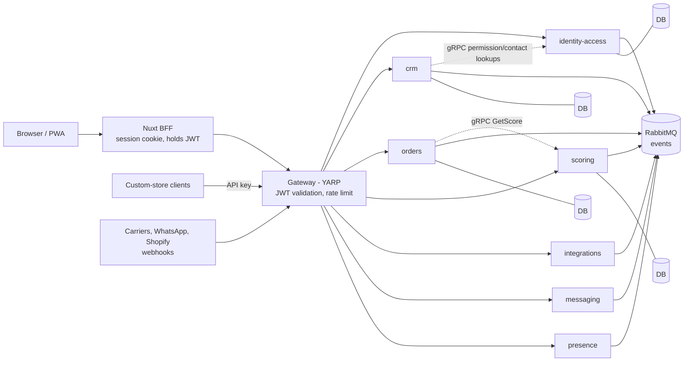

# Algerian CRM: Technology Decisions (v0.2)

Status: Draft 0.2, 5 November 2026. **Supersedes v0.1.** Companion to *CRM_Algeria_V1_Specification.pdf*.
Format: one decision record per topic: options, pros and cons, our pick, why, when to revisit.

Confidence tags: **[Certain]** verified against a source or our own decision; **[Likely]** strong inference or recalled knowledge, verify before relying on it; **[Guessing]** placeholder, needs a spike or data.

## Change log from v0.1

| Your decision | Effect in this document |
|---|---|
| Microservices, event-driven | Section 2 rewritten: service decomposition, data ownership, cross-service rules. Runtime becomes Kubernetes (section 9). A real broker is needed from the first milestone (section 3.3). |
| gRPC between services | Section 3.1: rules for where gRPC is allowed, and where it is not. |
| Nuxt + PrimeVue | Section 6 replaces the Next.js choice. RTL support verified against PrimeVue docs. |
| JWT with a BFF | Section 7 rewritten: identity service, token design, BFF flow. |
| `IFileStorage`, no MinIO | Section 5.4: interface and implementations; no storage product is named. |
| Legalities parked | Section 0.2: what changes, what I keep anyway, where it comes back. |

---

## 0. Read this first

### 0.1 My position has not changed

**I still disagree with microservices for V1. You gave a preference, not new information about team size, scale or deadlines, so my assessment stands: a modular monolith with event-driven internals is the lower-risk path. Here is what I would do instead: one codebase deployed as a monolith for the first three milestones, with the same module boundaries, extracting services on evidence. The risk in your approach is concrete: you will own N pipelines, N databases, N deployment configs, versioned contracts and distributed debugging before you have proved the score reduces returns, and the failure mode of an under-resourced microservices team is a distributed monolith that is slower to change than the monolith it replaced.**

The decision is yours, so this document is written to make microservices survive. Seven rules, each one traceable to a section:

1. **Services arrive with their milestone, not all at once** (2.2). Four services in the first skeleton, not eight.
2. **Draw boundaries by data ownership and consistency, not by module** (2.1). A module is not automatically a service.
3. **One service template** with auth, tracing, health, outbox, tenancy and resilience built in, so a new service costs hours, not weeks (4.1).
4. **Synchronous calls are the exception.** gRPC is allowed for fresh reads only; commands that change another service's state go through events (3.1).
5. **Contracts are code**: Protobuf with breaking-change checks, event JSON schemas with golden tests (3.1, 3.3).
6. **Observability before features**: distributed tracing across HTTP, gRPC and broker from the first walking skeleton (9.4).
7. **Tripwires** (section 14.2) that force a conversation about merging services back if the overhead shows up in the numbers.

### 0.2 Legalities are parked, with one hedge

I have removed legal constraints from the decision drivers, as you asked. Three consequences you should see:

- **Hosting is open again.** v0.1 defaulted to Algerian providers for legal reasons. Now it is a cost, latency and operations decision (section 9.1).
- **Hedge: portable by protocol.** If the legal question comes back and forces a move, it must be a migration and not a rewrite. So any managed service is allowed *if it speaks an open protocol and has a self-hostable equivalent*: Kubernetes, PostgreSQL, RabbitMQ (AMQP), S3 API, OTLP. Cloud-proprietary messaging, storage and identity are excluded. This costs little now and avoids a lock-in that would hurt later.
- **Cheap insurance I keep regardless:** hashed phone identities with a secret pepper, a consents table, tenant isolation by row-level security, audit log. These are good engineering independent of law.

The global cross-business score stays behind a feature flag for a product reason, not only a legal one: a shared negative-behaviour score invites sabotage and false reports. That is a product-risk argument, and the spec's anti-abuse design already covers it. Legal review is an item on the risk register (R1) and not a V1 gate.

### 0.3 One question

How many developers do you have, and how many have operated Kubernetes in production? The answer sets how aggressive the service roadmap can be.

---

## 1. Decision drivers

| ID | Driver | Implication |
|---|---|---|
| D1 | Small team, uncertain requirements | Fewest moving parts that satisfy the architecture; reversible choices |
| D2 | **Portability hedge** (replaces "Algerian hosting") | Open protocols only; no proprietary managed lock-in |
| D3 | Personal data is the core asset | Isolation, hashing, auditability by design |
| D4 | Multi-tenant SaaS, hard isolation | Row-level security inside every service database |
| D5 | Mobile-first, Arabic (RTL) and French, variable networks | Light pages, verified RTL support, PWA |
| D6 | Heavy integration surface | Idempotent inbox, adapters, replay, observability |
| D7 | Licence risk in the .NET ecosystem | Prefer MIT/Apache/BSD; avoid libraries with commercial pivots |
| D8 | Must evolve (global score, marketplace, payments, telephony) | Clean contracts and seams |
| D9 | Maintainability and hiring | Mainstream technologies |
| D10 | **Independent deployability and failure isolation** (new, from your choice) | Each service owns its data, deploys alone, degrades alone |

---

## 2. Architecture: microservices, event-driven

### 2.1 How to draw service boundaries (the "better way" than module = service)

A module is a code boundary. A service is a runtime, data and ownership boundary. Make something a service only when it passes most of these tests:

| Test | Question |
|---|---|
| Data ownership | Does it own a coherent dataset that nobody else needs to join against? |
| Consistency | Can its consumers tolerate eventual consistency? (If two things must change in one transaction, they belong together.) |
| Change rate | Does it change on a different cadence from its neighbours? |
| Scaling profile | Does it need different resources (CPU batch, long-lived connections, webhook spikes)? |
| Failure isolation | Should its outage leave the rest working? |
| Ownership | Could one team own it end to end? |

Rule of thumb: **split where the seams are already eventual, merge where the seams are transactional.** The order lifecycle and its shipments change state together, so they stay in one service even though the spec lists them as separate modules.

### 2.2 Service map and when each appears

| # | Service | Owns (database per service) | Appears | Why a service |
|---|---|---|---|---|
| 1 | **identity-access** | Users, auth identities, sessions, MFA, businesses, members, permissions, invitations, API keys | M0 | Token issuer for everyone; nothing else may own it |
| 2 | **crm** | Contacts, phones, tags, custom fields, pipelines, opportunities, interactions, call logs, tasks | M1 | Large, stable dataset; clear owner |
| 3 | **orders** | Products, orders, confirmation requests, order state machine, shipments, return cases | M2 | Transactional core: order, shipment and return states change together (merges Sales and Logistics from the spec) |
| 4 | **scoring** | Phone identities, signals, models, snapshots, consents, disputes | M3 | Different data sensitivity, batch recompute, may later need stricter access |
| 5 | **integrations** | Connections, webhook inbox, external refs, carrier/WhatsApp/Shopify/SMS/email adapters, imports | M4 | Absorbs third-party instability and webhook spikes; failure isolation |
| 6 | **messaging** | Conversations, messages, templates; real-time hub | M5 | Long-lived connections scale differently |
| 7 | **presence** | Public profiles, reviews, replies, reports (search later) | M5 | Public read-heavy surface; different scaling and caching |
| 8 | **platform** | Notifications, file metadata, audit log, feature flags, reference data | When needed | Starts as shared library code inside services; becomes a service when two or more services need the same capability at runtime |

Plus two edge components, not services: **gateway** (YARP) and **BFF** (Nuxt server, section 7).

**Honest sizing:** eight services plus gateway plus BFF is a lot to run. The schedule above is the compromise: M0 to M2 need only three services plus edge.

### 2.3 Topology



### 2.4 Data ownership rules

- **Database per service, no shared tables, no cross-database queries.** At the start, separate logical databases with separate credentials on one PostgreSQL cluster (cost); physical separation later without code change.
- **Row-level security inside every service database** keyed by `business_id` (see 5.2).
- **IDs are opaque UUIDs** shared across services; a foreign "key" to another service's entity is just a value, validated by event-fed read models or an occasional gRPC call, never by a database constraint.
- **The phone pepper** (secret used for `phone_hash`) is given to the services that need to compute hashes (crm, orders, scoring) from the secret store; only scoring stores the global layer. Widening the pepper to three services is a conscious trade-off versus a synchronous "resolve identity" call on every contact write.

### 2.5 How services get data they do not own

| Need | Pattern | Example |
|---|---|---|
| Fields needed on hot paths | **Local read model fed by events** (event-carried state) | orders keeps a snapshot of contact name and phone from `crm.contact.*` events |
| Fresh value needed at decision time, rare | **gRPC query** with deadline and fallback | orders asks scoring for the tier while creating an order |
| Reaction to something that happened | **Event** | scoring reacts to `orders.order.delivered` |
| Change in another service | **Command via event** (never a direct gRPC write) | orders emits `shipment.requested`; integrations acts on it |
| Cross-service report | Build a read model in the service that owns the report, or a later analytics store | Dashboard counts built in orders from its own data |

### 2.6 Smells that mean "merge these services"

Two services that always deploy together; a synchronous call chain longer than two hops; a distributed transaction appearing in a design review; the same entity edited in two services; most commits touching both repos or folders. Any of these triggers the tripwire review (14.2).

---

## 3. Communication

### 3.1 Service to service, synchronous: gRPC

| Option | Pros | Cons | Verdict |
|---|---|---|---|
| **gRPC (HTTP/2 + Protobuf)** | Contract-first, strongly typed, fast, deadlines and cancellation built in, streaming, first-class .NET support | Not browser-native (the BFF removes this issue); harder to debug by hand; HTTP/2 load balancing needs care; every RPC is a runtime coupling | **Chosen**, restricted use |
| REST/JSON between services | Easy to inspect; universal | Hand-maintained clients; no built-in deadlines; weaker contracts | Used only at the edge |
| Everything via events | Maximum decoupling | Awkward for queries needing an immediate answer | Default for commands and reactions |

**Rules (these matter more than the technology):**

1. gRPC is for **queries that must be fresh**. It is never used to change another service's state; that goes through events.
2. **Maximum one hop.** A service never calls a service that calls another service on the request path.
3. Every call has a **deadline** (default 1 to 2 s [Guessing]), a **retry only for idempotent reads**, and a **circuit breaker**, using `Microsoft.Extensions.Http.Resilience` or Polly v8 on the gRPC client handler.
4. Every caller has a **fallback** when the callee is down (cached value, "unscored", degrade the feature).
5. Propagate metadata via interceptors: `authorization`, `traceparent`, `x-correlation-id`, tenant.

**Initial internal API surface (kept small on purpose):**

| Callee | RPC | Caller | Fallback |
|---|---|---|---|
| scoring | `GetScore(phone_hash, business_id)` and `BatchGetScore` | orders, crm | Show "score unavailable"; allow order with default risk policy |
| identity-access | `CheckPermission(user, business, key)` (only when claims are insufficient) | any | Deny; claims cover most cases (7.2) |
| crm | `GetContact(id)` | orders (rare) | Use local read model |

**.NET specifics:** `Grpc.AspNetCore` on servers, `Grpc.Net.ClientFactory` on clients, `grpc.health.v1` health checks for Kubernetes, gRPC reflection in development only, Google `rpc.Status` for error details. **Load balancing:** a plain Kubernetes ClusterIP pins long-lived HTTP/2 connections to one pod **[Likely: well-known behaviour]**. Use a headless service with client-side round-robin (`Grpc.Net.Client` DNS resolver) or a mesh later; test this in spike S4.

**Contracts:** `.proto` files live in each service's `Contracts` project, published as private NuGet packages. Use **buf** (lint and breaking-change detection) in CI **[Likely: buf is an open-source tool for this]**. Never reuse or renumber a field.

### 3.2 Edge APIs: REST + OpenAPI

| Option | Pros | Cons | Verdict |
|---|---|---|---|
| **Services expose REST/OpenAPI for edge callers (BFF, custom stores), gRPC internally** | Standard for third-party integrators; generated typed Nuxt client; gateway-friendly | Two surfaces per service | **Chosen** |
| gRPC from the Nuxt server (grpc-js) | One surface | Node-side proto codegen and tooling overhead; custom stores still need REST | Rejected |
| gRPC JSON transcoding from the same `.proto` | One definition, both protocols | REST design constrained by proto annotations; awkward for uploads and long-polling **[Likely]** | Possible later for simple read APIs |

The internal gRPC surface is tiny (table above), so the duplication cost is small. Public custom-store API lives at the gateway under `/v1` with API-key authentication.

### 3.3 Asynchronous: events over RabbitMQ

| Option | Pros | Cons | Verdict |
|---|---|---|---|
| **RabbitMQ** (quorum queues) | Mature; per-message ack and dead-letter exchanges; flexible routing; moderate ops; open protocol (AMQP) so managed or self-hosted are interchangeable (D2) | Per-key ordering and replay are weaker than a log; needs discipline | **Chosen** |
| Kafka | Per-key ordering, replay (cheap projection rebuilds), huge throughput | Heavy to operate; overkill for V1 volume | Runner-up; reconsider if projection rebuilds by replay become routine across many services |
| NATS JetStream | Light, fast | Smaller .NET ecosystem and fewer operators **[Guessing]** | Not chosen |
| Azure Service Bus / SQS+SNS | Fully managed | Proprietary; breaks the portability hedge (D2) | Rejected |

**Topology:** one topic exchange per producing service (`crm.events`), one durable quorum queue per consuming service per source (`orders.crm-events`), dead-letter exchange and queue per consumer, routing key = event type. Broker credentials and vhost permissions per service.

**Reliability rules (every service):**

- **Transactional outbox** in the service database; relay publishes to RabbitMQ with publisher confirms; at-least-once delivery.
- **Idempotent consumers**: inbox table keyed by `(eventId, consumer)` or naturally idempotent upserts.
- **Version guards** for out-of-order delivery (`WHERE version < @incoming`), because RabbitMQ does not guarantee per-aggregate order across competing consumers **[Certain]**.
- **Bounded retries** with backoff, then dead-letter with context; replay tooling; alert on dead-letter depth above zero.
- **Tenant context from the event envelope** (`tenantId`), set transaction-locally before touching the database.
- Detailed patterns and code: the *building-event-driven-microservices-dotnet* skill.

**Messaging library: decide in spike S2.** Eight services means the outbox/inbox plumbing is written once, not eight times. Two options: (a) **Wolverine** (MIT **[Likely]**, built-in durable outbox/inbox with EF Core and RabbitMQ transport), or (b) an in-repo shared library over `RabbitMQ.Client`. MassTransit v9 is commercial and v8 maintenance ends after 2026 **[Certain]**, so it is out unless budgeted. Handlers only ever see plain event records, so the choice is reversible. My lean is Wolverine **[Likely]**, conditional on the spike passing.

**Event contracts:** CloudEvents-style envelope (`eventId`, `type`, `source`, `occurredAt`, `subject`, `tenantId`, `correlationId`, `causationId`), JSON via `System.Text.Json`, JSON Schema per event version in the contracts package, golden-file tests, additive-only changes, dual-publish for breaking changes. JSON over Protobuf for events keeps broker messages human-readable while debugging **[Likely trade-off]**; Protobuf for events is a valid alternative (one IDL, buf checks).

### 3.4 Flows: choreography first

| Flow | Style | Sequence |
|---|---|---|
| Order placed | Choreography | orders writes order + outbox → `orders.order.placed`. scoring and crm update read models. |
| Confirmation | Inside orders | State machine plus confirmation link; emits `order.confirmed` or `order.cancelled` |
| Shipment | Choreography | orders emits `shipment.requested` → integrations calls the carrier → `shipment.created` → orders updates |
| Carrier status | Choreography | Carrier webhook → gateway → integrations (inbox) → `shipment.status_changed` → orders advances the state machine → `order.delivered/returned/...` → scoring consumes → `score.updated` |
| Return | Inside orders | Return case, fault classification, restock; emits `return.received` |
| Reviews | Choreography | presence consumes `order.delivered` to enable review eligibility |

No saga engine in V1: every flow is a chain of local transactions with compensating events where needed. Introduce an orchestrator (framework saga or durable execution) only when a flow needs multi-step compensation across services.

**First-cut event catalogue**

| Event | Producer | Consumers |
|---|---|---|
| `identity.user.registered` | identity-access | platform (welcome email), crm (optional) |
| `identity.business.created`, `identity.member.changed` | identity-access | all services (tenant and permission read models) |
| `crm.contact.created/updated/merged` | crm | orders, messaging, scoring (link phones) |
| `crm.call.logged` | crm | scoring |
| `orders.order.placed/confirmed/cancelled` | orders | scoring, crm, integrations (notifications) |
| `orders.shipment.requested` | orders | integrations |
| `integrations.shipment.created/status_changed` | integrations | orders |
| `orders.order.delivered/refused/returned` | orders | scoring, presence, crm, platform |
| `scoring.score.updated` | scoring | orders, crm (cache of tier) |
| `messaging.message.received` | messaging | crm (timeline), platform (notifications) |
| `presence.review.posted` | presence | platform (notify business) |

---

## 4. Backend (per service)

### 4.1 Runtime and service template

**.NET 10 LTS, ASP.NET Core** (supported until 14 Nov 2028 **[Certain]**). Alternatives considered in v0.1 (Node, PHP, Java, Go, Python) are unchanged and not revisited.

**The service template is the single most important investment in a microservices setup.** A `dotnet new` template plus a shared `ServiceDefaults` package gives every service, with no per-service work:

- OpenTelemetry (traces, metrics, logs), Serilog with PII scrubbing, health endpoints (liveness, readiness, gRPC health)
- JWT bearer validation against the identity service's JWKS, tenant resolution from `tid` or the event envelope
- Transaction-scoped tenant setting for PostgreSQL RLS (5.2)
- Outbox/inbox plumbing and RabbitMQ wiring (or Wolverine, per S2)
- HTTP and gRPC resilience handlers, Problem Details error shape, OpenAPI generation
- Architecture and contract tests scaffolded, Dockerfile and Helm chart skeleton, CI workflow reuse

### 4.2 Libraries (unchanged choices, restated)

| Concern | Choice | Notes |
|---|---|---|
| Request handling | Plain handlers per use case (vertical slices) | MediatR is commercial **[Certain]** |
| Mapping | Manual or a source generator (Mapperly **[Likely]**) | AutoMapper is commercial **[Certain]** |
| Validation | FluentValidation **[Likely]** or built-in | Verify licence at adoption |
| Scheduling | Quartz.NET **[Likely]** where recurring jobs are needed | Per service, not a shared scheduler |
| Real time | SignalR in the messaging service | Redis backplane when scaled out |
| Phone parsing | libphonenumber-csharp **[Likely]** | Shared in the template |
| Local orchestration | Aspire AppHost (formerly .NET Aspire) **[Likely]** | Starts services, PostgreSQL, RabbitMQ, Valkey and the Nuxt app; confirm package names |

---

## 5. Data

### 5.1 Database

**PostgreSQL**, one database per service. Rationale, alternatives (SQL Server, MySQL/MariaDB, MongoDB, distributed SQL) and verdicts are as in v0.1 and unchanged: native row-level security, `jsonb`, partial indexes, free and portable (D2, D4). With managed PostgreSQL allowed under the protocol rule (9.1), it can run managed or self-hosted. Only use vanilla features and common extensions (`pg_trgm`, `unaccent`) so migration between providers stays possible.

### 5.2 Multi-tenancy inside each service

Shared schema with `business_id` and RLS per service database. Policy `business_id = current_setting('app.business_id')::uuid`; set **transaction-locally** (`set_config(..., true)`); application role is non-owner; EF Core global filters as a second layer; automated cross-tenant tests per endpoint and per consumer **[Certain: a session-level setting leaked through a pooled connection is the classic failure]**. In consumers, the tenant comes from the event envelope.

### 5.3 Data access and migrations

EF Core 10 (Npgsql) for commands, Dapper or raw SQL for read-heavy queries. **Migrations run as a separate deployment step per service** (Kubernetes Job or init container) generating reviewed, idempotent SQL; never auto-migrate on startup with several replicas.

### 5.4 Files: `IFileStorage`

No storage product is named; the application depends only on an interface.

```csharp
public interface IFileStorage
{
    Task<StoredFile> PutAsync(string key, Stream content, string contentType, CancellationToken ct);
    Task<Stream> OpenReadAsync(string key, CancellationToken ct);
    Task DeleteAsync(string key, CancellationToken ct);
    Task<Uri> GetDownloadUrlAsync(string key, TimeSpan ttl, CancellationToken ct);   // time-limited
    Task<UploadTicket> GetUploadTicketAsync(string key, string contentType, long maxBytes, TimeSpan ttl, CancellationToken ct);
}
```

| Implementation | Use | Notes |
|---|---|---|
| `LocalDiskFileStorage` | Development and tests | Zero dependencies |
| `S3FileStorage` | Production | The S3 API is an open protocol: configuration (endpoint, bucket, credentials) selects any compatible store, managed or self-hosted. Uses the AWS SDK for .NET against a custom endpoint **[Likely]** |
| `AzureBlobFileStorage` (optional) | If hosted on Azure | Only behind the interface; not a dependency of business code |

**Rules:** the browser uploads and downloads via **time-limited URLs**, not through services; metadata (owner, size, hash, purpose) lives in the owning service's database; keys are tenant-prefixed (`{businessId}/{purpose}/{uuid}`); an asynchronous scan step (for example ClamAV) marks files `clean` before they are served **[Likely]**; delete is a soft state first, then a sweep.

### 5.5 Other stores

| Need | Choice | Notes |
|---|---|---|
| Cache, BFF session store, rate limiting, SignalR backplane, revocation list | **Valkey** (BSD fork of Redis **[Likely]**) or managed Redis-compatible | Needed from M0 now (BFF sessions), not optional as in v0.1. Verify current licence of whichever you pick |
| Search | PostgreSQL `pg_trgm` + full text inside the owning service | A dedicated engine (Meilisearch or Typesense) enters with the presence service's discovery, both advertise Arabic support **[Likely]**, verify |
| Backups | Per-database PITR, restore drills scheduled | Managed or pgBackRest-style tooling |

---

## 6. Frontend: Nuxt + PrimeVue

### 6.1 Nuxt

| Option | Pros | Cons |
|---|---|---|
| **Nuxt (Vue 3, TypeScript)** | SSR/SSG for profile pages; **Nitro server layer is a natural BFF**; module ecosystem; `@nuxtjs/i18n` supports per-locale `dir` (including `rtl` for Arabic) **[Certain: shown in the module's own test fixtures]**; PrimeVue officially supported, including Nuxt 4 **[Certain: package changelog]** | Node runtime to operate; Vue talent pool smaller than React **[Likely]**; module version churn |
| Next.js | Larger ecosystem | You chose Nuxt; no new information against it |

**Pick:** Nuxt, as you decided. The BFF role (section 7.3) is a real argument for it: the same project hosts UI and the server-side token handling.

### 6.2 PrimeVue

| Aspect | Assessment |
|---|---|
| RTL | PrimeVue documents native RTL through CSS logical properties (inline-start, block-end); setting `dir="rtl"` is enough. **Carousel and Galleria are the documented exceptions** **[Certain: PrimeVue RTL guide]**. A changelog shows an overlay-position bug in RTL was fixed in 4.x **[Certain]**, so verify overlays (Select, Dialog, Popover, DatePicker) in your target version (spike S3) |
| Components | Very complete: DataTable (sorting, filtering, virtual scroll), TreeTable, DatePicker, Select, FileUpload, Chart wrapper, Stepper, Timeline; matches CRM screens (tables, forms, dialogs) |
| Theming | Design tokens with presets; styled and unstyled modes; Tailwind integration available **[Likely]** |
| Licence | Core library and the Nuxt auto-import resolver are MIT **[Certain for the resolver; Likely for the core]**; Figma kit, templates and UI blocks are paid add-ons **[Likely]** (not required) |
| Risks | Large surface means large bundles unless auto-import and tree-shaking are used; Kanban and chat are not provided (use `vue-draggable-plus` or similar); DataTable performance with very large datasets needs virtual scroll and server-side paging |

**Alternatives considered:** Vuetify, Quasar, Element Plus, Naive UI, Nuxt UI with Tailwind. None is clearly better for an RTL data-heavy CRM; PrimeVue's DataTable and documented RTL are the deciding factors **[Likely]**.

### 6.3 Frontend stack

| Concern | Choice |
|---|---|
| Server state | `@tanstack/vue-query` or Nuxt `useFetch`/`useAsyncData` with a typed client |
| Client state | Pinia (only where needed) |
| Forms and validation | PrimeVue Forms or VeeValidate with Zod |
| API client | Generated from each service's OpenAPI document (openapi-typescript with a fetch wrapper **[Likely]**); contract drift fails the build |
| i18n | `@nuxtjs/i18n`: Arabic (RTL) and French (LTR), ICU plurals, locale-driven `dir` |
| Numerals and fonts | Force Western digits for phones, prices, dates **[Likely: confirm with users]**; self-hosted Arabic-capable font (Noto Sans Arabic or IBM Plex Sans Arabic) |
| PWA | `@vite-pwa/nuxt` **[Likely]**; installable; offline queue for call dispositions as a stretch goal |
| Charts, Kanban | PrimeVue Chart (Chart.js) or ECharts; `vue-draggable-plus` for the pipeline board |
| Testing | Vitest, `@nuxt/test-utils`, Playwright in Arabic RTL and French |

Native mobile apps are not V1; automatic call telemetry would require an Android app and Google Play policy review **[Likely]**, so V1 keeps manual call dispositions.

---

## 7. Security and identity: JWT with a BFF

### 7.1 Identity service

| Option | Pros | Cons | Verdict |
|---|---|---|---|
| **ASP.NET Core Identity + OpenIddict** | OSS; issues standard OIDC and JWT access tokens; JWKS endpoint; refresh-token rotation; client credentials for service identities; lives inside the identity-access service | You assemble and own the flows (reset, lockout, MFA, consent pages) | **Chosen** |
| Keycloak | Full IdP: SSO, MFA, federation, admin UI; battle-tested | Separate Java service to operate; theming Arabic/French pages; heavier | Runner-up; strong if you need SSO or partner apps soon |
| ASP.NET Core Identity bearer tokens only | Built in | Tokens are not standard JWTs and not meant for multi-service validation **[Likely]** | Rejected |
| Duende IdentityServer | Mature | Commercial licence (D7) | Rejected |
| Auth0, Entra External ID, Clerk | Fast, managed | Proprietary; breaks the portability hedge (D2) | Rejected |

**Login UX:** the identity service hosts a small set of server-rendered pages (login, register, MFA, reset, Google sign-in redirect), localised in Arabic and French, with the BFF acting as a confidential OIDC client using authorization code with PKCE. Credentials never touch the BFF, and Google OAuth is handled where it belongs. **Fallback:** a first-party headless login API consumed by Nuxt forms (better visual consistency, but credentials pass through the BFF and it departs from standard OIDC). Choose after spike S1.

### 7.2 Token design

| Item | Decision |
|---|---|
| Access token | JWT, signed with rotating keys, **10 minutes** [Guessing], audience per service family |
| Claims | `sub`, `sid` (session id), `tid` (**active business id**), `role` (owner/staff/client), compact `perms` (when small) or `perm_ver` (version to look up), `locale` |
| Multiple businesses | A user may belong to several. The token carries **one active business**; switching business triggers a token exchange that issues a new token with a different `tid` |
| Refresh token | Rotating, single use, **reuse detection** revokes the family; lifetime 7 to 30 days [Guessing]; held only by the BFF |
| Validation | Each service validates signature, issuer, audience and expiry locally from cached JWKS; no call to identity on the hot path |
| Immediate revocation | Gateway checks `sid` against a Valkey revocation set (logout, suspension, password change); otherwise revocation latency equals access-token lifetime |
| Staleness | Permission changes apply on the next refresh (10 minutes) unless `perm_ver` is checked against a cache; acceptable for V1, force refresh for sensitive changes |
| System identities | Client-credentials tokens for background workers and service accounts, narrow scopes |

### 7.3 BFF flow (Nuxt server)

1. Browser talks only to the Nuxt origin. It holds a **sealed HttpOnly, Secure, SameSite=Lax cookie** (prefer a `__Host-` name) containing only a session id. **The JWT never reaches browser JavaScript.**
2. Access and refresh tokens live in **server-side session storage** (Valkey) keyed by session id; a sealed-cookie helper such as `nuxt-auth-utils` handles the cookie **[Likely]**.
3. Nitro routes `/api/**` proxy to the gateway, attaching `Authorization: Bearer <access token>`. The BFF refreshes the token when near expiry, with a **single-flight lock** so concurrent requests do not each refresh.
4. **CSRF:** SameSite plus an Origin check plus a required custom header on unsafe methods.
5. **Logout:** revoke refresh family, add `sid` to the revocation set, clear cookie.
6. **Real time:** the browser cannot send the JWT to a WebSocket, so the BFF mints a **short-lived one-time ticket** (about 30 seconds [Guessing]) the browser presents when connecting to the messaging hub through the gateway.
7. Security headers and CSP at the BFF; no tokens in logs.

Rejected: JWT in `localStorage` or readable cookies (XSS exposure), and a Single-Page-App-only design without a server component.

### 7.4 Service-to-service and broker security

- **User-context calls:** forward the user's JWT in gRPC metadata. **Background and event handling:** no user token; the event envelope carries `tenantId`, and the consumer sets tenant context itself.
- Broker: per-service credentials, vhost permissions, TLS. Kubernetes NetworkPolicies restrict which pods may reach which services. Mutual TLS through a service mesh is deferred.

### 7.5 Authorization

Policy-based checks per service using permission claims and tenant context, plus RLS as backstop. A permission change is an event (`identity.member.changed`) that services use to refresh local read models if they cache more than the token carries. External policy engines are not used in V1.

### 7.6 Other security decisions (largely unchanged)

| Concern | Choice |
|---|---|
| Passwords | Argon2id via custom `IPasswordHasher` with verify-and-rehash **[Likely]** |
| MFA | Mandatory TOTP for web_master and business owners; optional otherwise; no SMS MFA |
| Phone verification | WhatsApp authentication message (about US$0.004 per message to Algeria in public rate cards **[Likely]**), SMS fallback (about €0.08 to €0.20 **[Likely]**), plus clicked confirmation link |
| Secrets | SOPS or External Secrets in Kubernetes; envelope encryption for integration credentials; peppers and master keys outside the database |
| Transport | TLS everywhere; internal traffic over private network; mesh mTLS later |
| Supply chain | NuGet lock files, Dependabot/Renovate, SBOM, Trivy, CodeQL/Semgrep, gitleaks, private package feed with provenance |
| Abuse | ASP.NET Core rate limiting at gateway and per service, proof-of-work captcha on public forms **[Likely]** |

---

## 8. Integrations (owned by the integrations service)

Unchanged in substance from v0.1. Carriers are direct typed adapters (no aggregator, personal data stays with us), behind one interface; every adapter uses the webhook inbox, signature verification, idempotent processing, retries and replay.

| Integration | Notes |
|---|---|
| Carriers: Yalidine, ZR Express, Maystro, Ecotrack, Noest, E-com Delivery | API shapes seen only through third-party SDKs: Yalidine uses API id and token and needs the origin wilaya; ZR Express uses key plus tenant and signs webhooks; Maystro uses a store token and has no tracking endpoint **[Likely: not official docs]**. Verify with sandbox accounts (R3) |
| WhatsApp Cloud API | Algeria is a priced market (utility and authentication about US$0.004, marketing about US$0.02 per delivered message in spring 2026 summaries **[Likely]**). Business onboarding and billing for an Algerian entity is **unverified (R2)** |
| Shopify | Admin API, webhooks, HMAC verification; custom app per store first |
| Custom store | Public REST API at the gateway with API keys, `Idempotency-Key`, signed outbound webhooks |
| SMS, email | `ISmsSender`, `IEmailSender` interfaces, one provider each |
| Payments (mockup) | `IPaymentProvider` with a mock implementation |

---

## 9. Infrastructure and operations

### 9.1 Hosting (legal parked)

| Option | Pros | Cons | Verdict |
|---|---|---|---|
| **Managed Kubernetes with open-protocol managed data services** (PostgreSQL, RabbitMQ-compatible, S3-compatible) in a nearby region | Least ops for a small team; elasticity; mature tooling | Needs an international payment method; legal review may force a move later (protocol rule limits the cost) | **Recommended default** |
| Self-managed Kubernetes (k3s or kubeadm) on rented VMs, anywhere | Most portable; cheapest at scale | You run the control plane, upgrades, storage, backups | Fallback, or if a local provider is required later |
| Docker Compose on VMs | Simplest | Not viable for 6 to 8 services plus rollout needs | Rejected for microservices |
| Serverless/container-apps PaaS | Low ops | Proprietary specifics; gRPC and long-lived connections vary by platform | Rejected (D2) |

### 9.2 Runtime and delivery

| Concern | Choice |
|---|---|
| Orchestration | **Kubernetes**; Helm or Kustomize per service from the template; GitOps with Argo CD or Flux **[Likely]** |
| Ingress | NGINX or Traefik ingress to the gateway; cert-manager for TLS |
| Autoscaling | HPA on CPU; KEDA on RabbitMQ queue depth for consumers **[Likely]** |
| Mesh | None in V1; revisit Linkerd for mTLS and gRPC balancing if needed |
| CI | GitHub Actions: one reusable workflow, per-service path filters, build, test, scan, push image, bump GitOps manifest |
| Config and secrets | Environment and ConfigMaps; secrets via External Secrets or SOPS |
| Environments | local (Aspire), CI (Testcontainers), staging (synthetic data), production; ephemeral preview environments if budget allows |
| Releases | Trunk-based, feature flags (`global_score_visible` off), expand-and-contract migrations, rolling or canary with health-gated rollout |

### 9.3 Resource sketch [Guessing]

Eight .NET services at roughly 150 to 300 MB each idle, plus gateway, Nuxt, PostgreSQL, RabbitMQ, Valkey and observability: plan for a three-node cluster with about 4 vCPU and 16 GB per node before load, and validate with the walking skeleton.

### 9.4 Observability from day one

OpenTelemetry in the service template, with W3C trace context propagated through HTTP, gRPC metadata and RabbitMQ headers (and stored in the outbox row so traces survive the outbox hop). Collector to Prometheus (metrics), Loki (logs), Tempo (traces), Grafana, Alertmanager; managed Grafana-compatible services are acceptable under the protocol rule. Must-have alerts: outbox oldest-unpublished age, dead-letter depth per queue, consumer lag, gRPC error and deadline-exceeded rates, token refresh failures, replication lag, backup freshness.

---

## 10. Scoring service

Unchanged logic: C# rules engine with versioned parameters (`score_models`), transparent reason codes, ONNX Runtime later for models trained in Python. It is a service because it consumes many events, recomputes in batches, and owns the global layer. Exposes `GetScore` and `BatchGetScore` over gRPC with a cached projection as fallback for callers. A model is adopted only if it beats the rule baseline on a held-out backtest.

---

## 11. Quality engineering

| Area | Practice |
|---|---|
| Unit tests | xUnit; `FakeTimeProvider`; avoid FluentAssertions in new code (commercial pivot) |
| Architecture tests | No cross-service references except Contracts packages |
| Contract tests | `buf breaking` on proto; golden JSON per event version; consumer tolerant-reader tests; optional consumer-driven contracts (Pact) |
| Service integration | Testcontainers (PostgreSQL, RabbitMQ, Valkey) per service |
| Tenant isolation | Every endpoint and every consumer attempts cross-tenant access |
| Reliability | Duplicate delivery, out-of-order events, broker down, relay crash, poison message |
| End to end | A small ephemeral-environment suite (order → confirmation → shipment webhook → return → score update) in Arabic and French; keep it small, it is slow |
| Resilience | Kill a service during a flow and verify degradation, replay and recovery |
| Load | k6 on gateway, webhook ingestion, outbox throughput |
| Standards | `.editorconfig`, analyzers, nullable, warnings as errors, central package management, ADRs, conventional commits |

---

## 12. Decision summary

| Area | Choice | Runner-up | Main reason | Confidence |
|---|---|---|---|---|
| Architecture | Microservices, event-driven (**your decision; I disagree**) | Modular monolith | D10 (yours); D1 against | [Likely] that the runner-up is lower risk |
| Boundaries | By data ownership and consistency; 8 services staged by milestone | One service per module | Avoid distributed transactions | [Likely] |
| Sync comms | gRPC, fresh-read queries only, one hop | REST | Contracts, deadlines | [Likely] |
| Edge API | REST + OpenAPI via YARP gateway | gRPC transcoding | Integrators, generated client | [Likely] |
| Async comms | RabbitMQ + outbox/inbox | Kafka | Ops weight, portability | [Likely] |
| Messaging library | Wolverine or shared library (spike S2) | MassTransit v8 | MIT, built-in outbox | [Guessing] until spike |
| Runtime | Kubernetes, GitOps | k3s | Six or more deployables | [Likely] |
| Backend | .NET 10 LTS | Node/NestJS | LTS to Nov 2028 | [Certain] on support dates |
| Database | PostgreSQL per service, RLS | SQL Server | Tenant isolation at DB level | [Likely] |
| Frontend | Nuxt + PrimeVue (**your decision**) | Next.js + shadcn | RTL documented, DataTable, BFF host | [Likely] |
| Identity | ASP.NET Core Identity + OpenIddict | Keycloak | Standard JWT, portable | [Likely] |
| Browser auth | BFF with server-side tokens, HttpOnly session cookie (**your decision**) | SPA with tokens | XSS resilience | [Certain: standard guidance] |
| Files | `IFileStorage` with S3-protocol and local implementations (**your decision**) | Product-specific SDK | Portability | [Certain] |
| Cache/session | Valkey or Redis-compatible | In-memory | BFF sessions, revocation, backplane | [Likely] |
| Observability | OpenTelemetry + Grafana stack | Vendor APM | Open protocol | [Likely] |

---

## 13. Licence and supply-chain watchlist

| Library or product | Status | Stance |
|---|---|---|
| MediatR, AutoMapper | Moving to commercial licensing **[Certain]** | Avoid |
| MassTransit | v8 Apache-2.0, official maintenance ends after 2026; v9 commercial **[Certain]** | Avoid for new work unless budgeted |
| FluentAssertions | Announced commercial licence **[Certain: community reports]** | Avoid in new tests |
| Duende IdentityServer | Commercial | Avoid |
| Redis | Licence changes **[Likely]** | Prefer Valkey or verify |
| HashiCorp Vault | Source-available **[Likely]** | Use External Secrets/SOPS; OpenBao if a vault is needed |
| PrimeVue | MIT core **[Likely]**; paid templates, blocks, Figma kit optional | Use core only |

Every new dependency gets a one-line licence and maintenance check in the pull request; review this table quarterly.

---

## 14. Risks, spikes and tripwires

### 14.1 Risks and spikes

| ID | Risk or question | Spike (time-box) |
|---|---|---|
| **S1** | **Walking skeleton**: gateway + Nuxt BFF + identity-access + crm; OIDC code+PKCE login, JWT validation, session store, gRPC call crm→identity, outbox→RabbitMQ→consumer, trace spanning all hops, deployed to the target Kubernetes | **2 weeks.** This single spike validates most of the microservices bet; do it before committing to the roadmap |
| S2 | Wolverine vs shared library for outbox/inbox | 3 days: implement `order.placed` end to end both ways; compare code, tests, failure behaviour |
| S3 | PrimeVue RTL: DataTable, Dialog, Select, DatePicker overlays, forms, in Arabic | 3 days |
| S4 | gRPC load balancing and deadlines on the chosen Kubernetes (headless service vs mesh) | 2 days |
| S5 | RLS with EF Core, pooling, and consumers setting tenant from envelope | 2 days, adversarial tests |
| S6 | Login UX: identity-hosted pages vs headless login API | Decide at end of S1 |
| R1 | **Legal (parked):** hosting location, transfers, global score, consent. Comes back before the global score is enabled or before choosing production hosting | Written opinion from an Algerian data-protection lawyer; not a V1 gate |
| R2 | WhatsApp onboarding and billing for an Algerian entity **[Guessing]** | 3 days: attempt directly and via a BSP |
| R3 | Carrier API access and webhook behaviour (only third-party SDK docs reviewed) | Sandbox accounts, capture real status vocabularies (1 week) |
| R4 | Team size and Kubernetes experience (question 0.3) | Answer before locking the roadmap |

### 14.2 Tripwires (agreed in advance, so the conversation is not emotional later)

Review the architecture if any of these is true after M2:

1. More than about 30% of engineering time goes to platform plumbing (pipelines, contract fixes, environment issues) rather than features.
2. Median lead time from merged change to production exceeds one working day.
3. A synchronous call chain longer than two hops, or a cross-service transaction, appears in a design.
4. Two services change together in most commits.
5. Local development needs more than a couple of commands, or most of the team cannot run the full flow on a laptop.

Remedy options, in order: merge the offending services, extend the service template, then reconsider the roadmap (including the modular monolith).

---

## 15. Sources and confidence notes

Verified in this session or the previous one (November 2026):

- .NET support policy: .NET 10 LTS released 11 Nov 2025, supported until 14 Nov 2028 (dotnet.microsoft.com).
- MassTransit v9 commercial announcement (masstransit.io); community coverage of MediatR, AutoMapper, MassTransit and FluentAssertions commercial transitions (milanjovanovic.tech, dev.to).
- PrimeVue RTL guide (primevue.org/guides/rtl): native RTL via CSS logical properties, Carousel and Galleria exceptions; PrimeVue auto-import resolver changelog (MIT; Nuxt 4 support; RTL overlay fix); Nuxt i18n module fixtures showing per-locale `dir: 'rtl'`.
- WhatsApp per-message pricing with an Algeria line (Meta documentation and third-party summaries of the spring 2026 rate card); SMS pricing and sender-ID notes for Algeria (aggregator pages). Prices change; re-check before budgeting.
- Carrier API shapes: third-party SDK repositories (dz-delivery, Dolivroo), not official documentation.

Not verified: Wolverine feature details, OpenIddict and `nuxt-auth-utils` specifics, Valkey and Redis current licence terms, KEDA and Argo CD versions, carriers' official terms, WhatsApp onboarding for an Algerian entity. Each is tagged **[Likely]** or **[Guessing]** where used and has a spike or an owner above.
