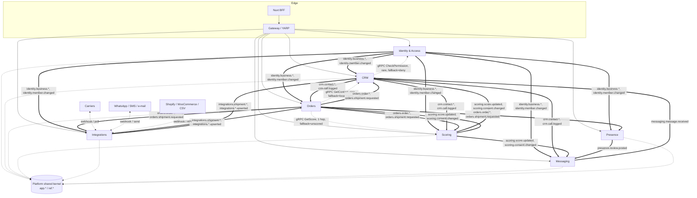

# Bounded contexts and context map (Phase 1)

Status: **Proposed** (Phase 1 gate, pending 1b independent review). Sources: Tech Decisions v0.2 §2 (service map,
data ownership), CLAUDE.md §6 (functional scope map), `docs/02-data/*.md` (already built — this document names
the contexts the schemas already committed to; it does not re-derive them from scratch).

Precedence note: seven of the eight planned contexts already exist as **built, validated database schemas**
(`docs/02-data/*.md`, `src/Services/*/Database/`). This document is the Phase 1 artefact that CLAUDE.md §8 and
`docs/00-context/gap-analysis.md` (G11) flagged as owed *before* schemas — written after instead, on explicit
product-lead direction. Where this doc and a service's own `docs/02-data/<service>.md` disagree on a boundary
question, the data-design doc wins (it is the thing actually running); raise the conflict rather than silently
picking one.

## 1. The contexts

| # | Context | Milestone | Owns (ubiquitous language) | Pattern role |
|---|---|---|---|---|
| 1 | **Identity & Access** | M0 | User, LoginMethod, Session, Business (tenant), Membership, Permission, Invitation, ApiKey, FeatureFlag | Upstream for everyone — token issuer, tenant registry |
| 2 | **CRM** | M1 | Contact, Phone, Address, Relationship, Tag, CustomField, Pipeline, Opportunity, Task, Interaction, CallLog | Core domain — the merchant's customer book |
| 3 | **Orders** | M2 | Product, Order, OrderItem, OrderStatusHistory (two machines: order + cash), ConfirmationRequest, Shipment, ReturnCase, CodRemittance | Core domain — the transactional spine |
| 4 | **Scoring** | M3 | PhoneIdentity, Signal, ScoreModel, TenantScore, GlobalScore, Consent, Dispute, DataSubjectRequest | Core domain, two planes (tenant / global) |
| 5 | **Integrations** | M4 | IntegrationConnection, WebhookEvent, ExternalRef, CarrierShipment, CarrierRequest, ImportJob | Anti-corruption layer to every third party |
| 6 | **Messaging** | M5 | Conversation, Message, MessageTemplate, ChannelConsentState, Notification | Core domain + platform-ish (notifications) |
| 7 | **Presence** | M5 | BusinessProfile, Review, ReviewReply, Report, RatingParameters | Supporting domain — the public surface |
| 8 | **Platform** | library now | Outbox, Inbox, AuditLog, FileMetadata, TenantReadModel | Shared kernel (literally: `app.*` / `ref.*` SQL, not a service) |

Context #8 is **already realized**, not a future service: `src/BuildingBlocks/Database/sql/C0001-C0003` is the
shared-kernel SQL every other context imports. Tech Decisions v0.2 §2.2 names the trigger for promoting it to a
real service ("when two or more services need the same capability at runtime") — not crossed in V1.

## 2. Context map

Legend: solid thin arrow = gRPC (synchronous, ≤1 hop, deadline+fallback, Tech Decisions v0.2 §3.1); thick double
arrow = events (async, outbox→RabbitMQ→inbox); dotted = shared kernel / external webhook.

## 3. DDD relationship pattern per context pair

| Upstream | Downstream | Pattern | Why |
|---|---|---|---|
| Identity & Access | every other context | **Customer-Supplier**, upstream wins | Tenant/permission read models (`app.tenants`, `member_refs`-style) are Conformist copies; downstream never overrides what identity-access says about a business |
| CRM | Orders | **Published Language** (events) | Orders keeps a contact/phone snapshot at order time (legally required — "show what was confirmed even if the contact changes later") rather than conforming live; deliberate divergence, not laziness |
| CRM | Scoring | **Partnership**-leaning, mediated by events only | Scoring never reads crm's database; `phone_hash` is the only shared concept, and even that is independently computed from the pepper, not passed as a foreign key |
| Scoring | Orders / CRM | **Published Language**, tenant layer only | `scoring.score.updated` carries tier+confidence only (CLAUDE.md §5); this is a hard boundary enforced in code (`ck_contact_score_cache_no_global_reasons` in crm) and schema (scoring's own `net` vs `public` split), not a convention |
| Integrations | Orders / CRM | **Anti-Corruption Layer** (textbook) | `carrier_status_mappings` translates every carrier's raw vocabulary to one normalised set before anything crosses the boundary; orders/crm never see a carrier's native status string |
| Messaging | CRM | **Published Language** | `messaging.message.received` feeds the crm timeline; crm never queries messaging's database |
| Presence | Messaging | **Proposed, not yet realised** | No Messaging→Presence relationship exists today — Presence's order-basis eligibility (`orders.order.delivered`) is already covered by the Orders→Presence row above. A conversation-basis eligibility event (`presence.md` open question 1) is not yet named in any event catalogue; this row is a placeholder for that, not a decided pattern |
| Platform (shared kernel) | all | **Shared Kernel** | Literally shared SQL (`app.*`), not a service — every context pays the coordination cost of a shared schema in exchange for not re-inventing outbox/inbox/RLS/partitioning seven times |

## 4. Resolving G7 — marketing, service desk, workflow automation, reporting

`docs/00-context/gap-analysis.md` G7 and CLAUDE.md §6 flagged these as unassigned, "Phase 1 must decide before
M3." M3 (scoring) is already built, so this decision is overdue relative to the original schedule — resolved
now, formally in **ADR-0007**, summary here:

| Area | Home | Why |
|---|---|---|
| **Marketing** — segment/list definitions | **CRM** | A segment is a saved query over `contacts`/`tags`/`contact_score_cache`; crm already owns every field a segment filters on |
| **Marketing** — campaign execution, sends, attribution | **Messaging** | Messaging already owns `message_templates`, `channel_consent_states` and the only channel-send mechanism (D1 of `messaging.md` already absorbed WhatsApp templates from integrations for exactly this reason); a campaign is "send this template to this segment, respecting consent" — no new aggregate root needed, no 8th service |
| **Service / support desk** | **CRM** | Cases/tickets are structurally identical to `opportunities` (a tracked thing against a contact, with stages/assignee/SLA) and share crm's `interactions` timeline; a dedicated service would duplicate crm's contact/interaction ownership for no consistency benefit (Tech Decisions v0.2 §2.6's merge-smell test, cited by ADR-0002: "the same entity edited in two services") |
| **Workflow automation** | **New context, deferred** (no schema yet) | The only area that genuinely does not fit an existing aggregate: it reacts to *any* event from *any* service with conditions/actions, which is exactly the shape v0.2 §2.2 describes as the trigger for a new service once something needs cross-service capability at runtime. Not built in Phase 2; scheduled after M5 once there is enough event volume to automate against |
| **Reporting** | **No new service; per-service read replica + materialised views (V1), columnar store later** | CLAUDE.md §4 "do not run reports on OLTP primaries" is an infra pattern, not a bounded context. Single-service KPIs (confirmation/delivery/return rate — all `orders`-only) are views on that service's own replica. Cross-service KPIs (e.g. revenue by score tier, joining `orders` + `scoring`) get a purpose-built materialised view owned by whichever service's handler can cheapest maintain it from events it already consumes, until volume justifies a CDC-fed columnar store (Tech Decisions v0.2 §10 "no saga engine... introduce only when needed" — same philosophy applied to analytics) |

Service/support desk and marketing additions to crm/messaging are **not built in Phase 2** — the existing crm
and messaging schemas (`src/Services/Crm`, `src/Services/Messaging`) cover only what their `docs/02-data/*.md`
already specified. This document records *where* the future tables go, not new DDL.

## 5. Open items carried from Phase 0/2 that this document does not resolve

- G3 (wilaya dataset), G8 (Wolverine vs in-repo, spike S2), G9/G10 (legal gate, erasure policy), G1 Q3 (order
  numbering is resolved; order-creation race with scoring's "unknown → UNSCORED" fallback, `scoring.md` open Q3,
  still needs a product decision on which side moves first).
- Messaging's own open question 2 ("review eligibility needs a `messaging.conversation.review_eligible` event")
  is a Phase 3 contract decision, not a boundary question — noted here so it isn't lost between documents.
