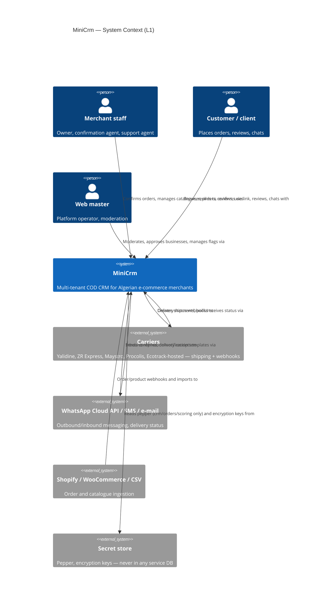

# C4 diagrams — L1 System Context, L2 Container (Phase 1)

Status: **Proposed** (Phase 1 gate). Source: Tech Decisions v0.2 §2.3 (topology), §4 (backend), §5 (data),
§6 (frontend), §9 (infra) — this redraws that material as formal C4, with the 7 built services' actual
container boundaries (one Postgres database per service, not one shared cluster box).

## L1 — System Context

## L2 — Container

```mermaid
C4Container
  title MiniCrm — Container (L2)

  Person(merchant, "Merchant staff")
  Person(client, "Client")

  System_Boundary(minicrm, "MiniCrm") {
    Container(nuxt, "Nuxt BFF", "Nuxt server", "Session cookie, holds JWT server-side, generated OpenAPI clients")
    Container(gw, "Gateway", "YARP", "JWT validation, rate limit per tenant/key, routes to /v1")

    Container(ia, "identity-access", ".NET 10 minimal API", "Users, businesses, members, permissions, feature flags")
    Container(crm, "crm", ".NET 10 minimal API", "Contacts, pipelines, interactions, call logs")
    Container(ord, "orders", ".NET 10 minimal API", "Products, orders, order+cash state machines, shipments, returns")
    Container(sco, "scoring", ".NET 10 minimal API", "Contact Score — tenant + global planes")
    Container(intg, "integrations", ".NET 10 minimal API", "Carrier/WhatsApp/store adapters, webhook inbox, imports")
    Container(msg, "messaging", ".NET 10 minimal API", "Conversations, templates, notifications, real-time hub")
    Container(prs, "presence", ".NET 10 minimal API", "Public profiles, reviews, moderation")

    ContainerDb(dbia, "identity_access DB", "PostgreSQL 18", "")
    ContainerDb(dbcrm, "crm DB", "PostgreSQL 18", "")
    ContainerDb(dbord, "orders DB", "PostgreSQL 18", "")
    ContainerDb(dbsco, "scoring DB", "PostgreSQL 18", "")
    ContainerDb(dbintg, "integrations DB", "PostgreSQL 18", "")
    ContainerDb(dbmsg, "messaging DB", "PostgreSQL 18", "")
    ContainerDb(dbprs, "presence DB", "PostgreSQL 18", "")

    ContainerQueue(mq, "RabbitMQ", "Quorum queues", "One exchange per producer, one durable queue per consumer per source")
    ContainerDb(cache, "Valkey", "Redis-compatible", "BFF sessions, revocation list, score-lookup stampede guard")
  }

  System_Ext(carriers, "Carriers")
  System_Ext(whatsapp, "WhatsApp / SMS / e-mail")
  System_Ext(stores, "Shopify / WooCommerce / CSV")

  Rel(merchant, nuxt, "HTTPS")
  Rel(client, nuxt, "HTTPS")
  Rel(nuxt, gw, "REST, JWT in Authorization header")
  Rel(gw, ia, "REST /v1")
  Rel(gw, crm, "REST /v1")
  Rel(gw, ord, "REST /v1")
  Rel(gw, sco, "REST /v1")
  Rel(gw, intg, "REST /v1, webhooks")
  Rel(gw, msg, "REST /v1, WebSocket/SSE")
  Rel(gw, prs, "REST /v1, anonymous read")

  Rel(ord, sco, "gRPC GetScore, 1 hop, deadline+fallback")
  Rel(crm, ia, "gRPC CheckPermission, rare")

  Rel(ia, dbia, "EF Core, RLS")
  Rel(crm, dbcrm, "EF Core, RLS")
  Rel(ord, dbord, "EF Core, RLS")
  Rel(sco, dbsco, "EF Core, RLS")
  Rel(intg, dbintg, "EF Core, RLS")
  Rel(msg, dbmsg, "EF Core, RLS")
  Rel(prs, dbprs, "EF Core, RLS")

  Rel(ia, mq, "outbox relay publishes / inbox consumes")
  Rel(crm, mq, "outbox relay publishes / inbox consumes")
  Rel(ord, mq, "outbox relay publishes / inbox consumes")
  Rel(sco, mq, "outbox relay publishes / inbox consumes")
  Rel(intg, mq, "outbox relay publishes / inbox consumes")
  Rel(msg, mq, "outbox relay publishes / inbox consumes")
  Rel(prs, mq, "outbox relay publishes / inbox consumes")

  Rel(nuxt, cache, "session store")
  Rel(sco, cache, "score lookup single-flight cache")

  Rel(intg, carriers, "REST/webhook")
  Rel(intg, whatsapp, "REST/webhook")
  Rel(intg, stores, "REST/webhook")
```

## Notes

- Each service's **own** PostgreSQL database is drawn explicitly (no shared cluster box) because "database per
  service, no shared tables" (CLAUDE.md §3) is the single most load-bearing constraint in this system; collapsing
  them into one `PostgreSQL` container would hide the thing a reviewer most needs to check.
- `gw -> *` is REST/OpenAPI (Tech Decisions v0.2 §3.2); the only internal gRPC surface is the two calls in the
  table at §3.1, both already drawn — nothing else gets a direct arrow between two service containers.
- `platform` (context #8 in `bounded-contexts.md`) does not appear as a container: it is `app.*`/`ref.*` SQL
  inside every `ContainerDb` above, not a deployable. Drawing it as a box would misrepresent what actually runs.
- Milestone sequencing (who exists when) is in `bounded-contexts.md` §1, not repeated here — this diagram shows
  the target end-state topology, not M0's subset.
