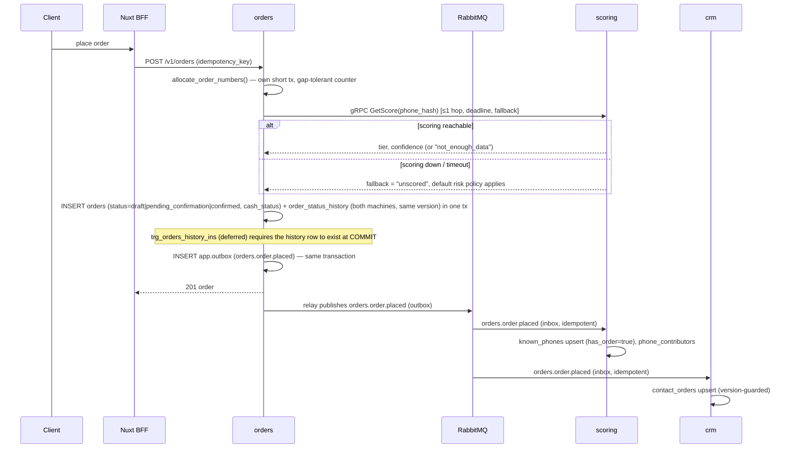
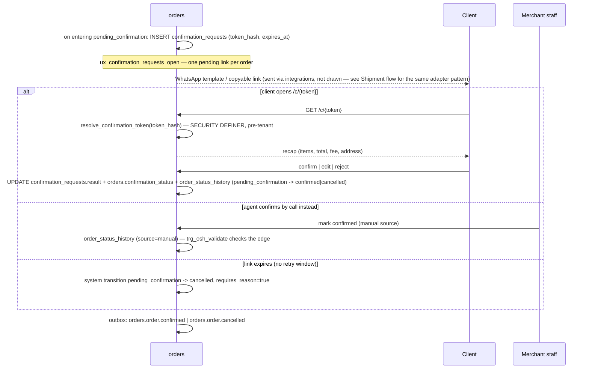
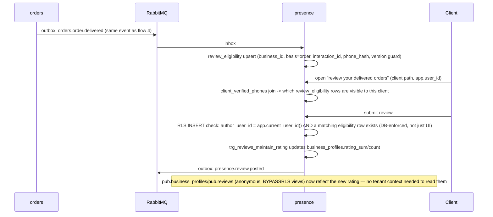

# Sequence diagrams — the 6 flows (Phase 1)

Status: **Proposed** (Phase 1 gate). The 6 flows are Tech Decisions v0.2 §3.4's own list ("choreography
first"); each diagram below is grounded in the actual tables/triggers/functions already built and validated in
Phase 2 (`src/Services/*/Database/migrations/V0001__initial.sql`), not invented fresh — where this disagrees
with v0.2's one-line description, the schema (the thing that actually runs) is noted as the source of the extra
detail.

**Phase 2 built the database only — no application/consumer code exists yet for any service.** Every step named
above that reads as a trigger, function or table name (`trg_osh_validate`, `resolve_confirmation_token`,
`claim_carrier_requests`, …) is real and tested. Steps that read as *application logic calling into* those
objects — most visibly flow 4's scoring recompute step below — describe the target behaviour the schema was
built to support, not code that runs today. `scoring.md`'s own scaffold-honesty note is explicit: "there is no
recompute engine, nightly decay job, or velocity/sabotage detection yet." Phase 5/6 implement the consumers;
until then, a step like "phone_signals INSERT -> recompute" means "the tables and guards this will write through
are ready," not "this already happens."

## 1. Order placed (choreography)



## 2. Confirmation (inside orders)



## 3. Shipment (choreography)

```mermaid
sequenceDiagram
  participant ORD as orders
  participant MQ as RabbitMQ
  participant INT as integrations
  participant Carrier

  ORD->>ORD: confirmed|processing -> shipped triggers outbox: orders.shipment.requested
  ORD->>MQ: relay publishes
  MQ->>INT: orders.shipment.requested (inbox)
  INT->>INT: claim_carrier_requests() picks up the create op (idempotency_key, SECURITY DEFINER, cross-tenant worker)
  INT->>Carrier: push(entity) via the carrier's adapter
  alt carrier accepts
    Carrier-->>INT: tracking number, label
    INT->>INT: carrier_shipments (status=created), carrier_requests (succeeded)
    INT->>MQ: outbox: integrations.shipment.created
  else carrier rejects / times out
    INT->>INT: carrier_requests (failed|retryable) — claim_carrier_requests will retry if retryable
    INT->>MQ: outbox: integrations.shipment.creation_failed
  end
  MQ->>ORD: integrations.shipment.created | .creation_failed (inbox)
  ORD->>ORD: shipments row updated; order_status_history if the order's own status moves
```

## 4. Carrier status (choreography) — the longest chain, exactly as built

```mermaid
sequenceDiagram
  participant Carrier
  participant GW as Gateway
  participant INT as integrations
  participant MQ as RabbitMQ
  participant ORD as orders
  participant SCO as scoring

  Carrier->>GW: webhook POST
  GW->>INT: routed by route_key (public, pre-tenant)
  INT->>INT: resolve_webhook_connection_by_route() — SECURITY DEFINER, BYPASSRLS
  INT->>INT: set app.business_id (now RLS-governed) + verify signature
  alt signature valid
    INT->>INT: ingest_webhook_event() — webhook_event_keys dedup (D4), stores raw payload
  else signature invalid
    INT->>INT: ingest_webhook_event(status=ignored, take_dedup_key=false) — D6: never blocks the genuine redelivery
  end
  INT-->>Carrier: 200 (store-first; process async)
  INT->>INT: claim_webhook_events() worker picks it up
  INT->>INT: carrier_status_mappings lookup (frozen, versioned) -> normalised status
  INT->>MQ: outbox: integrations.shipment.status_changed (our vocabulary only — no carrier string crosses this line)
  MQ->>ORD: inbox, idempotent via (event_id, consumer)
  ORD->>ORD: trg_osh_validate — a carrier event can never move the order backwards (anomaly -> shipment_events, flagged, not applied)
  ORD->>ORD: order_status_history + orders.status/cash_status, both at the new version
  ORD->>MQ: outbox: orders.order.delivered | .refused | .returned
  MQ->>SCO: inbox
  SCO->>SCO: phone_signals INSERT (weight derived from score_models by provenance, never trusted from the caller) -> recompute -> tenant_scores/global_scores
  SCO->>MQ: outbox: scoring.score.updated (tenant layer only — never reasons/counts, CLAUDE.md §5)
  MQ->>ORD: inbox: rm_score_tiers upsert
```

## 5. Return (inside orders)

```mermaid
sequenceDiagram
  participant ORD as orders
  participant Agent as Merchant staff

  Note over ORD: return_cases opens when delivery_failed-with-no-retry OR return_in_transit is reached (trigger on order_status_history, not drawn separately — same transaction)
  ORD->>ORD: INSERT return_cases (status=open, reason_code, fault_class copied from reason_code)
  Agent->>ORD: "Mark received"
  ORD->>ORD: guard_return_case_edge validates open->received, logs return_case_history
  Agent->>ORD: restock decision
  alt sellable
    ORD->>ORD: received -> restocked, closed_at set
  else not sellable
    ORD->>ORD: received -> written_off, closed_at set
  end
  opt fault contested
    Agent->>ORD: change fault_class (business admits wrong item, etc.)
    Note over ORD: spec §5.7 — invalidates the earlier customer-failure signal; outbox: orders.return.fault_changed (Phase 3 contract, not yet named in v0.2's catalogue)
  end
  ORD->>ORD: outbox: orders.return.received
```

## 6. Reviews (choreography)



## Cross-cutting notes that apply to every flow above

- Every arrow crossing a service boundary that is drawn as a plain line (not `->>` into the same box) is either
  the outbox→RabbitMQ→inbox path or the two gRPC calls in `c4-diagrams.md` — nothing else. No flow above has a
  synchronous call chain longer than one hop (Tech Decisions v0.2 §3.1 rule 2; tripwire §14.2.3 if that ever
  changes).
- "Choreography first... no saga engine in V1" (v0.2 §3.4) holds for all 6: every multi-step flow above is a
  chain of independent local transactions, each service reacting only to events it already consumes, with no
  central orchestrator and no distributed transaction.
