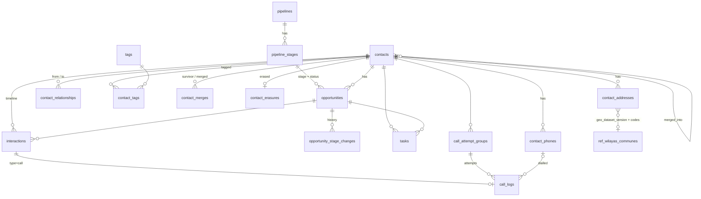

# crm — data design (database `crm`)

Status: **Proposed** (Phase 2). DDL: `src/Services/Crm/Crm.Infrastructure/Database/migrations/V0001__initial.sql`
(applied after C0001–C0003, geo included). Tests: `…/Database/tests/T0001..T0003`. Validated on PostgreSQL 18.7
(Docker `minicrm-pg`) with `tools/db/bootstrap-service-db.sh crm Crm --geo --reset` → `OK crm`.
Sources: V1 spec §1.3, §4.1–4.2, §4.5, §4.10, §5.2–5.4, §8.4 · Tech Decisions v0.2 §2.2–2.5, §3.3–3.4 · CLAUDE.md §5–7 · ADR-0001…0005.

## 1. Purpose and ownership

**Owns:** contacts (B2C/B2B, persons and organisations), their phones, addresses, relationships, tags, custom field
definitions (and the values for contacts/opportunities), merge and erasure history, pipelines, stages, opportunities,
tasks, the unified interaction timeline, call attempt groups and structured call logs (source of `crm.call.logged`).

**Does not own:** users/members/businesses (identity-access), orders, products, quotes, shipments (orders),
phone identities, signals, scores, consents, data-subject requests (scoring), import jobs, connections, external refs
(integrations, v0.2 §2.2), conversations/messages/templates (messaging). Those reach crm only as opaque ids or event-fed
read models (`contact_orders`, `contact_score_cache`, `member_refs`, `app.tenants`, timeline rows).

## 2. Table catalogue

| Table | Spec table(s) | Scope | Append-only | Partitioned |
|---|---|---|---|---|
| `contacts` | contacts | tenant | no (soft delete, merge, anonymise) | no |
| `contact_phones` | contact_phones | tenant | no | no |
| `contact_addresses` | contacts.wilaya_code/commune/address_text | tenant | no | no |
| `contact_relationships` | — (CLAUDE.md §6 "relationships") | tenant | no | no |
| `tags`, `contact_tags` | tags / contact_tags | tenant | no | no |
| `custom_field_definitions` | custom_field_definitions | tenant | no | no |
| `contact_merges` | — (§5.2 "writes an audit entry") | tenant | yes (`loser_snapshot`, `redacted_at` may change) | no |
| `contact_erasures` | — (§4.1 erasure) | tenant | yes | no |
| `pipelines`, `pipeline_stages` | pipelines / pipeline_stages | tenant | no | no |
| `opportunities` | opportunities | tenant | no | no |
| `opportunity_stage_changes` | — (CLAUDE.md §7 status log) | tenant | yes | no |
| `tasks` | tasks | tenant | no | no |
| `interactions` | interactions | tenant | yes (`contact_id`, `summary`, `payload`, `redacted_at` may change) | monthly on `occurred_at` |
| `call_attempt_groups` | call_logs.attempt_group_id | tenant | no (locked counter row) | no |
| `call_logs` | call_logs | tenant | yes (`contact_phone_id`, `phone_hash`, `redacted_at` may change) | monthly on `occurred_at` |
| `contact_orders` | read model (orders.order.*) | tenant | no (upsert, version guard) | no |
| `contact_score_cache` | read model (scoring.score.updated) | tenant | no (upsert, version guard) | no |
| `member_refs` | read model (identity.member.changed) | tenant | no (upsert, version guard) | no |

20 tables, all tenant-scoped with forced RLS. Plus the shared `app.*` (outbox, inbox, audit_log, files, tenants) and
`ref.*` geo tables. No seed file: the only per-business default (the pipeline) is tenant data, created by
`create_default_pipeline()` from the `identity.business.created` consumer.

## 3. ERD (inside this service)

External refs (opaque uuids, no FK): `owner_member_id`, `assignee_member_id`, `actor_member_id`, `*_by_member_id` →
identity_access.business_members; `client_user_id` → identity_access.users; `order_id` → orders.orders;
`import_job_id` → integrations.import_jobs; `request_ref` → scoring.data_subject_requests; `phone_hash` ↔ scoring.phone_identities.
Read models (`contact_orders`, `contact_score_cache`, `member_refs`) have no FK by design (async, rebuildable).

All in-service FKs are **composite `(business_id, …)`** against `UNIQUE (business_id, id)`, so a leaked foreign id from
another tenant can never be linked (tested in T0001).

## 4. Deviations from the spec

| # | Deviation | Why / winning source |
|---|---|---|
| D1 | `contact_phones.phone_identity_id` → `phone_hash bytea` (HMAC-SHA256) | ADR-0002, v0.2 §2.4; scoring owns phone identities |
| D2 | FKs to businesses/business_members/users/orders → opaque uuids + comments | ADR-0002 |
| D3 | `contacts.wilaya_code/commune/address_text` → child `contact_addresses` with `geo_dataset_version`, commune code, landmark, free-text fallback | CLAUDE.md §7 (versioned geo, 58→69 wilayas), C0003; several addresses per contact. Orders snapshots the confirmed address |
| D4 | `contacts.email citext` → `text` + `lower(email)` index, app stores lower-case | conventions §2 extension allow-list (pg_trgm, unaccent only) |
| D5 | Added `contacts.kind` (person/organization), `preferred_language`, `import_job_id`, `search_text`, `anonymised_at`, `merged_at`, `version` | CLAUDE.md §6 (companies + persons), §7 (ar/fr), conventions (version), erasure |
| D6 | Added `contact_relationships`, `contact_merges`, `contact_erasures`, `opportunity_stage_changes` | CLAUDE.md §6/§7, spec §5.2 audit of merge, §4.1 erasure |
| D7 | `call_logs.attempt_group_id` backed by a `call_attempt_groups` row | Spec §5.4 "attempt_no increments automatically" needs a serialisation point; a partitioned `call_logs` cannot hold a global UNIQUE. Row is locked `FOR UPDATE`, gives `attempt_no` and the counts for the 3-attempt escalation proposal |
| D8 | `call_logs` gets `occurred_at` (partition key, = interaction's), `phone_hash`, `contact_phone_id`, `redacted_at`; PK `(interaction_id, occurred_at)` | Partitioning (conventions §6); signal must carry the dialled phone's hash |
| D9 | `interactions` PK `(id, occurred_at)`, `source_event_id`, `redacted_at` added | Partitioning; projection idempotency; erasure |
| D10 | `contact_phones.status` (`active/wrong_number/invalid`) and `line_type` | Spec §5.2 (`line_type`), §5.4 (wrong_number flags the phone) |
| D11 | `pipeline_stages.system_key` | UI translation of seeded stages (ar/fr) |
| D12 | `import_jobs` **not** in crm | v0.2 §2.2: integrations owns `import_jobs`/`import_rows`. Imported contacts arrive through crm's normal create/upsert path (driven by integrations, dedup by `(business_id, phone_e164)`); crm returns the resolved/deduplicated contact id in `crm.contact.created/updated/merged`, which integrations maps in `external_refs`. crm keeps only `contacts.import_job_id` (opaque) |
| D13 | Trigram GIN indexes do not start with `business_id` | GIN on uuid needs `btree_gin` (not allowed). RLS filters after the index scan. See R1 |
| D14 | Read-model tables keyed by natural keys (`(business_id, order_id)`, …), not `id uuid` | Same pattern as `app.tenants`; upsert target |

Opportunity rule (spec §5.3) is declarative: FK `(business_id, pipeline_id, stage_id, status)` →
`pipeline_stages (business_id, pipeline_id, id, stage_type)` forces status = stage type and that the stage belongs to
the pipeline; `ck_opportunities_state` stamps `won_at`/`lost_at` and requires `lost_reason`. Call rule (spec §5.4):
`answered` ⇔ outcome + `answered_at`; other dispositions forbid both.

## 5. Indexes ↔ queries

| Index | Query / screen / handler |
|---|---|
| `uq_contact_phones_e164 (business_id, phone_e164)` | Spec §4.10; quick-add/dedup on create and import → merge flow |
| `ux_contact_phones_primary`, `ix_contact_phones_contact` | Contacts list primary phone; contact detail phones; merge re-pointing |
| `ix_contact_phones_hash (business_id, phone_hash)` | `scoring.score.updated` consumer; "phone in my contacts" anti-oracle check before a score lookup |
| `ix_contact_phones_e164_trgm` (GIN) | Contacts list search by phone fragment |
| `ix_contacts_last_interaction` (partial, live) | Contacts list default sort (spec §4.10) |
| `ix_contacts_search_trgm` (GIN, partial) | Contacts list search by name/org/e-mail (accent- and hamza-insensitive) |
| `ix_contacts_owner` | Contacts list filter owner / "my contacts" |
| `ix_contacts_email` | Dedup on create/import by e-mail |
| `ix_contacts_client_user` | Linking a registered client to contacts (client portal, identity.user.* consumer) |
| `ux_contact_addresses_default`, `ix_contact_addresses_contact` | Default address prefill for "convert to order"; contact detail |
| `uq_contact_rel` / `ix_contact_rel_to` | Relationships of a person / people of an organisation |
| `ux_tags_name`, `ix_contact_tags_tag` | Tag picker uniqueness; contacts list filter by tag, bulk tag |
| `uq_custom_field_key` | Settings › custom fields; validation on write |
| `ix_contact_merges_survivor` | Contact detail "merged from" |
| `ux_pipelines_default`, `uq_pipelines_name` | Default pipeline lookup; pipeline picker |
| `uq_pipeline_stages_*` | Board column order (deferrable for reorder); composite FK targets |
| `ix_opportunities_board` (partial open) | Pipeline board (Kanban) |
| `ix_opportunities_contact` | Contact detail opportunities |
| `ux_opportunities_order` | Idempotent convert-to-order and auto-won-opportunity consumer (spec §5.3) |
| `ix_opp_stage_changes_opp` | Opportunity drawer history, cycle-time report |
| `ix_tasks_assignee_open` (partial) | Tasks › my tasks, dashboard "tasks due" |
| `ix_tasks_contact`, `ix_tasks_opportunity` | Contact detail / opportunity drawer tasks |
| `ux_tasks_source_interaction` | Idempotent callback task from `callback_requested` |
| `ix_interactions_contact (business_id, contact_id, occurred_at DESC)` | Contact timeline (spec §4.10) |
| `ix_interactions_opportunity`, `ix_interactions_order` | Opportunity drawer timeline; call workbench card (previous calls for the order) |
| `ux_interactions_source_event`, `ux_interactions_external_msg` | Projection replay idempotency; WhatsApp message dedup |
| `ux_call_attempt_groups_open_order` | Call workbench: open group for (order, purpose) |
| `ix_call_attempt_groups_contact` | Contact detail call history; merge |
| `ix_call_logs_group` | Attempt list per group (attempt counter, escalation proposal) |
| `ix_contact_orders_contact` | Contact detail orders tab, last order, totals |
| `ix_contact_score_cache_tier` | Contacts list filter by tier |

## 6. Events

**Produced** (written to `app.outbox` in the same transaction; `aggregate_version` = row `version`):
`crm.contact.created / updated / merged` (contacts + phones incl. e164 and hash; merged carries survivor + loser ids),
`crm.contact.erased` (proposed, Q4), `crm.call.logged` (from `call_logs` + `call_attempt_groups`: phone_hash, purpose,
attempt_no, disposition, outcome, order_id, telemetry_source, occurred_at — no names, no raw phone).
Opportunity/task events are not in the v0.2 catalogue; add when a consumer (automation, Q6) exists.

**Consumed** (idempotent via `app.inbox`; tenant from envelope):

| Event | Tables |
|---|---|
| `identity.business.created` | `app.tenants`; `create_default_pipeline()` |
| `identity.business.*` | `app.tenants` |
| `identity.member.changed` | `member_refs` (version guard) |
| `orders.order.placed/confirmed/cancelled/delivered/refused/returned` | `contact_orders` upsert (guard on `source_version`); `interactions` row type `system` (`source_event_id`); optional auto-won `opportunities` row (business setting, spec §5.3) |
| `scoring.score.updated` | `contact_score_cache` (tier + confidence; reasons only for layer `tenant`) |
| `messaging.message.received` | `interactions` (type whatsapp/sms/email/chat, `external_message_id`) |

All projections are rebuildable from the outbox archive of the producers; `contact_orders.contact_id` is re-pointed in
the merge transaction (orders also re-points on `crm.contact.merged`).

## 7. Partitioning and retention

| Table | Partitioning | Retention [Guessing — confirm with product/legal] |
|---|---|---|
| `interactions` | monthly RANGE `occurred_at`, DEFAULT partition | Online 36 months, then detach + archive (timeline is the CRM's memory) |
| `call_logs` | monthly RANGE `occurred_at` (same value as its interaction) | Same as interactions; detach `call_logs` partition **before** the matching `interactions` one (FK) |
| `app.outbox` / `app.inbox` / `app.audit_log` | building block | per conventions |
| others | none (bounded by contacts) | live data; soft delete |

Partitions are created last in V0001 after RLS/grants; `app.ensure_monthly_partitions` locks them (`app.lock_partitions`),
and T0001/T0003 assert direct partition reads/inserts are denied to `crm_app`. Backdated rows older than the partition
window land in DEFAULT (alert) — matters only if historic timelines are imported (not V1).

## 8. Security notes

- RLS forced on all 20 tables (`tenant_isolation`), runtime role non-owner; T0001 attacks every table (SELECT, UPDATE,
  DELETE, forged INSERT, no-tenant read) and checks the list is complete against the catalog.
- Helper functions (`create_default_pipeline`, `erase_contact`) are SECURITY INVOKER and refuse to run without a tenant.
- **PII columns:** contacts names/org/email/display_name/custom_fields; contact_phones `phone_raw`, `phone_e164`;
  addresses; interactions `summary`/`payload`; tasks `title`/`notes`; opportunities `title`; `contact_merges.loser_snapshot`.
  `phone_hash` is pseudonymous (HMAC-SHA256, pepper from the secret store, never stored). No secrets stored here.
- **Score privacy:** `ck_contact_score_cache_no_global_reasons` makes it impossible to store global-layer reasons.
- **Erasure (structural):** `erase_contact()` in one transaction deletes phones, addresses, relationships, now-unused
  score-cache rows; redacts interactions (`summary`, `payload`), call_logs (`phone_hash`; disposition kept), tasks,
  opportunity titles, merge snapshots; anonymises the contact (CHECK `ck_contacts_anonymised` keeps it anonymised) and
  writes `contact_erasures` (no PII). Order history (`contact_orders`) stays: no PII. Append-only whitelists include exactly
  the redaction columns. The caller adds `app.audit_log` + outbox event. `app.audit_log.diff` must never hold PII values
  for contact fields (record field names only) because audit rows cannot be redacted.

## 9. Open questions

1. **Imports transport** (home settled: integrations): is the create/upsert driven by a command event from integrations
   or by a crm bulk endpoint? Either way the event back carries the resolved contact id plus the import row reference. [Likely event]
2. Custom fields for entity `order`: definitions live here, values in orders. Publish `crm.custom_field_definition.changed`
   for orders to validate? [Guessing]
3. Tenant-layer reason codes: the spec's contact header shows "reasons"; CLAUDE.md §5 allows detail for the tenant layer
   only. Schema allows `reason_codes` for `layer='tenant'` only — confirm scoring sends them on `score.updated`.
4. Erasure scope across services: should crm emit `crm.contact.erased` so orders/messaging redact their snapshots
   (orders' legal need to keep the confirmed recap vs erasure)? Scoring copy of `phone_hash` signals = gap G10 (legal).
5. Call log correction: logs are append-only; a mis-clicked disposition needs a correction flow (new log flagged
   `corrects`?) or a short edit window — product decision. [Guessing]
6. Opportunity/task events and stage "stuck" thresholds wait for the automation-service decision (G7).
7. Lost reasons: free text per spec; promote to a per-business picklist (crm-sales-pipeline skill) before analytics?
8. Soft-deleted contacts keep their phones, so `UNIQUE (business_id, phone_e164)` makes re-creating the same number
   "restore the old contact". Intended? [Likely yes]
9. Who creates a contact for an order arriving by webhook with an unknown phone — orders (via event to crm) or
   integrations calling crm? Affects `contacts.source` values (`shopify`, `api` exist).

## 10. Requests to building blocks

- **R1** Allow `btree_gin` (trusted contrib) so trigram GIN indexes can lead with `business_id` (conventions §2 rule
  "business_id first in every index" currently cannot hold for text search).
- **R2** `ref.communes`: add `UNIQUE (dataset_version, code, wilaya_code)` so services can FK "commune belongs to wilaya"
  declaratively; crm uses a trigger meanwhile.
- **R3** (done by orchestrator) partition lock — crm's earlier local workaround removed; it also enabled RLS on
  partitions, which is redundant once the runtime role has no privilege on them.
- **R4** `app.audit_log`: document the no-PII-in-diff rule as a hard rule (append-only rows cannot be erased).
