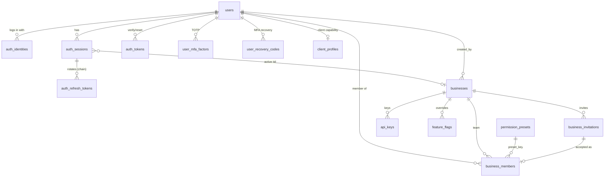

# identity-access — data design (Phase 2)

Status: **Proposed** (Phase 2 gate). Database `identity_access`. Files:
`src/Services/IdentityAccess/IdentityAccess.Infrastructure/Database/{migrations/V0001__initial.sql, seed/S0001__permissions_presets_flags.sql, tests/T0001..T0003}`.
Validated on PostgreSQL 18.7 (Docker `minicrm-pg`) with `tools/db/bootstrap-service-db.sh identity_access IdentityAccess --geo --reset` → `OK identity_access`.
Sources: Spec §1.3, §3, §4.3, §4.9, §4.10, §5.1, §8.5 · v0.2 §2.2, §3.3, §7 · ADR-0002…0005 · conventions.

## 1. Purpose and ownership

**Owns:** humans (`users`), login methods, sessions and refresh-token chains, MFA, single-use e-mail tokens, the tenant
registry (`businesses`), memberships and granular permissions, invitations, API keys, the client capability
(`client_profiles`), the permission catalogue and presets, and feature flags (ADR-0005). It is the token issuer
(ASP.NET Core Identity + OpenIddict, v0.2 §7.1) and the source of `identity.*` events every other service uses for
tenant/permission read models.

**Does not own:** phone identities/scores (scoring; we keep only `phone_hash`), public business profiles and reviews
(presence), notifications (messaging, M5; before that a library `IEmailSender`, no table), carrier mappings
(integrations), break-glass access grants (not designed yet, Q7). `app.tenants` exists (C0002) but stays empty here —
`businesses` is the source.

## 2. Table catalogue

| Table | Spec table | Scope | Append-only | Partitioned |
|---|---|---|---|---|
| `users` | users | platform | no (never deleted: DELETE revoked) | no |
| `auth_identities` | auth_identities (external logins only, D2) | platform | no | no |
| `auth_sessions` | auth_sessions (= refresh-token family, `sid`) | platform | no | no |
| `auth_refresh_tokens` | auth_sessions.refresh_token_hash (split out, D3) | platform | no (`used_at` flips) | **monthly by `issued_at`** |
| `auth_tokens` | auth_tokens | platform | no | no |
| `user_mfa_factors` | — (v0.2 §2.2/§7.6 MFA) | platform | no | no |
| `user_recovery_codes` | — (v0.2 §7.6 MFA) | platform | no | no |
| `businesses` | businesses | **tenant (RLS on `id`)** | no (DELETE revoked) | no |
| `business_members` | business_members | **tenant** | no (DELETE revoked) | no |
| `business_invitations` | business_invitations | **tenant** | no | no |
| `api_keys` | — (v0.2 §2.2 "API keys") | **tenant** | no | no |
| `client_profiles` | client_profiles | platform (user-level) | no | no |
| `permissions` | §3.2 permission keys (as data) | platform, read-only at runtime | — | no |
| `permission_presets` | §3.3 presets (as data) | platform, read-only at runtime | — | no |
| `feature_flags` | feature_flags (§4.9, ADR-0005) | mixed: global rows + per-business rows (RLS read policy) | no | no |
| `app.outbox/inbox/audit_log/files` | building blocks (C0002) | — | audit_log yes | yes |

**Tenant vs platform — why.** A user exists before and across businesses (spec §1.3: owner of A, staff of B, client
too), and login/lookup-by-email, Google callback, refresh, password reset all run **before any tenant is chosen** —
so `users`, identities, sessions and tokens cannot be tenant-RLS'd; they are protected by **grants** (below) and by the
fact that only identity-access can connect to this DB. Everything that belongs to one business (team, invitations,
keys, per-business flags, the business row itself) is RLS'd so that a buggy handler acting for B can never read A.
The three pre-tenant paths into tenant tables use narrow `SECURITY DEFINER` functions (owner = migrator, BYPASSRLS):
`auth_resolve_api_key(hash)`, `auth_resolve_invitation(hash)`, `auth_list_user_memberships(user_id)`.
Token issuance for a chosen business sets `app.business_id` to that business and reads the membership under RLS.
Creating a business: the app generates the id, sets the tenant to it, then inserts business + owner member + outbox.

## 3. ERD (inside this service)

External refs (no FK, ADR-0002): `client_profiles.phone_hash` → scoring.phone_identities. In-DB FKs to building
blocks/reference: `users.avatar_file_id` → `app.files` (SET NULL); `businesses`/`client_profiles` `(wilaya_dataset_version,
wilaya_code)` → `ref.wilayas` (RESTRICT). `auth_sessions.oidc_authorization_id` → `oidc.authorizations` (V0002, Q1).

## 4. Deviations from the spec (and ASP.NET Identity / OpenIddict mapping)

| # | Deviation | Why / winning source |
|---|---|---|
| D1 | `citext` email → `email` (as typed) + `email_normalized = lower(btrim(email))` UNIQUE (CHECK-enforced) | Conventions allow only pg_trgm/unaccent; also maps Identity `NormalizedEmail` (custom lower-case `ILookupNormalizer`) |
| D2 | `auth_identities` holds external providers only (`google`); password = `users.password_hash` | Spec's `provider_subject = email` for password duplicates `users.email` and goes stale on email change; maps 1:1 to Identity `IUserLoginStore` |
| D3 | Refresh tokens in `auth_refresh_tokens` (full chain), `auth_sessions` = family | Keeping only current/previous hash misses reuse of older rotated tokens; v0.2 §7.2 requires family revocation on reuse |
| D4 | `businesses.status` adds `closed` (terminal) | `app.tenants` (C0002) already uses it; owner-guard and deletion need a terminal state |
| D5 | `slug` globally unique (not business_id-first) | Public URL namespace `/b/{slug}`, not tenant data |
| D6 | Global uniques/indexes not led by `business_id`: `api_keys.secret_hash`, `business_invitations.token_hash`, `business_members(user_id)` | These are pre-tenant credential/directory lookups; under future tenant sharding they become a directory. Conventions rule otherwise kept |
| D7 | `client_profiles.phone_identity_id` → `phone_raw/phone_e164/phone_hash` (all-or-none with proof) | ADR-0002 (no FK into scoring); hash is the join key scoring understands |
| D8 | Token/secret hashes are `bytea` (32 bytes, CHECK) instead of `text` | Shape enforced in DB; impossible to store a clear token by mistake |
| D9 | `feature_flags` unique = `(business_id, key) NULLS NOT DISTINCT`; `scope` kept with a consistency CHECK | Spec's `(key, scope, business_id)` lets duplicate global rows through (NULLs distinct) and breaks business_id-first |
| D10 | Added `users.security_stamp, access_failed_count, lockout_end, version`; MFA tables; `api_keys` | Identity stores + v0.2 §2.2/§7.6 (MFA, API keys) — higher precedence than the spec's column list |

**Identity/OpenIddict tables EF would add — and what we do instead.** ADR-0004 is SQL-first, so EF creates nothing.
- ASP.NET Core Identity is used through **custom stores** over our tables, so **no `AspNet*` tables**:
  `AspNetUsers`→`users`; `AspNetUserLogins`→`auth_identities`; `AspNetUserTokens` (authenticator key, recovery codes)
  →`user_mfa_factors`/`user_recovery_codes` (encrypted/hashed, unlike Identity's clear default);
  `AspNetRoles/UserRoles/RoleClaims`→ **not used** (roles are contextual: `platform_role` + `business_members`);
  `AspNetUserClaims`→ not used (claims derived); `AspNetUserPasskeys` (.NET 10) → not in V1. `UserName` = email.
  `ConcurrencyStamp` → `version`.
- **OpenIddict** EF stores need 4 tables. They will be written by hand in `V0002__openiddict.sql` after spike S1, in a
  separate schema **`oidc`** (`oidc.applications`, `oidc.authorizations`, `oidc.scopes`, `oidc.tokens`, mapped with
  `ToTable(..., "oidc")`) so nothing collides with `public` (our `auth_*` names, `permissions`, `api_keys`).
  Mapping: `oidc.applications` = BFF confidential client + client-credentials service identities; `oidc.authorizations`
  ↔ `auth_sessions` (1:1 via `oidc_authorization_id`); `oidc.tokens` overlaps `auth_refresh_tokens` (Q1).
- EF mapping caveat: column grants exclude `users.platform_role` and `businesses.trust_weight/verified_*`; EF must mark
  them `PropertySaveBehavior.Ignore` (before and after save) in the runtime context, otherwise INSERTs fail with 42501.

## 5. Indexes ↔ queries

| Index | Query / handler |
|---|---|
| `ux_users_email_normalized` | Login, sign-up duplicate check, Google link-by-verified-email, invitation accept (email match) |
| `ux_auth_identities_provider_subject` / `_user_provider` | Google callback lookup by `sub`; "linked logins" in account settings; one Google link per user |
| `ix_auth_sessions_user_active` (partial) | Sign out everywhere, password change, user suspension, web-master "force logout" (spec §8.5) |
| `ix_auth_sessions_expires` | Daily purge of expired/revoked sessions |
| `ix_auth_refresh_tokens_hash` | Refresh (`/connect/token`): find token by hash; queries add `issued_at > now() - max_lifetime` to prune partitions |
| `ix_auth_refresh_tokens_session` | FK cascade when a session is purged |
| `ux_auth_tokens_hash`, `ux_auth_tokens_live` (partial) | Verify-email/reset link; "one live token per purpose" (issuing invalidates the previous) |
| `ux_user_mfa_factors_live`, `ux_user_recovery_codes` | MFA challenge (load factor by user); recovery code check by (user, hash) |
| `ux_businesses_slug`, `ix_businesses_pending` (partial) | Slug availability in onboarding; web-master "Businesses" approval queue |
| `ux_business_members_user (business_id, user_id)` | Team screen, membership check at token issuance, owner-guard count (teams are small) |
| `ix_business_members_user_active` (partial, D6) | `auth_list_user_memberships` — business switcher, login landing |
| `ux_business_invitations_token` / `_open` (partial) | Invitation link resolve; one open invite per email; "pending invitations" list |
| `ux_api_keys_secret_hash` / `ux_api_keys_prefix` | API-key authentication (hot path, per request); key list in integrations settings |
| `ux_client_profiles_user` / `_phone_hash` (partial) | Client profile load; one proven owner per phone (recycled numbers re-prove) |
| `ux_feature_flags_key` | Flag evaluation (global row + business override); console list |

## 6. Events

**Produced** (outbox, same transaction; contracts in Phase 3): `identity.user.registered` (users),
`identity.user.status_changed` [Likely] (users: suspended/deleted → services drop sessions/caches),
`identity.business.created` / `identity.business.updated` (businesses: status, trust_weight, verified, name — feeds
every `app.tenants` and scoring's trust weight), `identity.member.changed` (business_members: role, permissions,
data_scope, status, `version` = `perm_ver`), `identity.client.phone_verified` [Guessing] (client_profiles → scoring
self-view), `identity.feature_flag.changed` (feature_flags). The flag event is written **by trigger**
(`trg_feature_flags_outbox`) because flags are written by several principals (migrator seed, `set_feature_flag()`,
future admin role) and the event must never be skipped; no-op updates emit nothing; payload `{key, scope, businessId,
enabled, removed, version}`, `tenant_id` = business_id (NULL for global). The seed emits the initial
`global_score_visible=false` event so consumers start from an explicit OFF.
**Consumed:** none in V1 [Likely].

## 7. Partitioning and retention

| Table | Rule |
|---|---|
| `auth_refresh_tokens` | Monthly partitions (`app.ensure_monthly_partitions`, partitions locked by `app.lock_partitions`); drop partitions older than max family lifetime + 1 month (≤ 2 months) |
| `auth_sessions` | Delete 30 days after `expires_at`/`revoked_at` (keeps IP/UA only as long as needed) |
| `auth_tokens` | Delete 30 days after expiry/use |
| `user_recovery_codes` | Used codes deleted when a new set is generated |
| `business_invitations` | Expired/revoked kept 90 days [Guessing] (audit), then deleted by the migrator job; accepted kept (membership provenance) |
| `users` | Never hard-deleted; erasure = anonymise e-mail (`deleted+<id>@invalid`), name, password, identities, profile phone; status `deleted` |
| `businesses`, `business_members`, `api_keys` | Never deleted (history, audit references) |
| `app.audit_log` | Building-block retention (per conventions) |

## 8. Security notes

- **RLS**: `business_members`, `business_invitations`, `api_keys` via `app.enable_tenant_rls`; `businesses` custom
  policy on `id`; `feature_flags` SELECT-only policy (global rows + own tenant). Unset tenant ⇒ 0 tenant rows.
- **Grants replace RLS on platform tables** and also narrow tenant tables: runtime role cannot write
  `users.platform_role` (no privilege escalation from a code bug — web masters are promoted by the migrator/admin),
  `businesses.trust_weight/verified_*` (scoring weight is web-master-only), `business_members.business_id/user_id`,
  `api_keys.secret_hash/key_prefix`; no DELETE on users/businesses/members/invitations/keys/profiles; catalogue and
  flags read-only (flags only via `set_feature_flag()`, which also checks the actor is an active `web_master` and audits).
  Honest gap: the runtime role can still SELECT all `users` rows (needed for login); a missing filter in a tenant
  handler could list e-mails of other tenants' people — mitigated only by code review and by joining users through RLS'd
  `business_members`. Q5 proposes a view.
- **Hashes** (algorithm per column): passwords argon2id PHC (CHECK prefix); refresh/verify/reset/invitation tokens and
  API keys SHA-256 of ≥256-bit random secrets (bytea 32, CHECK); recovery codes HMAC-SHA256 with pepper (secret store);
  TOTP seeds AES-256-GCM under an external envelope key (`key_id` stored). Peppers/keys never in the DB.
- **Owner guard** (spec §4.10): deferred constraint triggers on `business_members` (insert/update of role,status/delete)
  and `businesses` (insert, status change) — `SECURITY DEFINER`, lock the business row `FOR UPDATE`, then require ≥1
  active owner unless `closed`. Allows ownership transfer inside one transaction. Tested (T0002).
- **MFA** mandatory for web_master and owners (v0.2 §7.6) is enforced at login (forced enrolment), not by a DB constraint.
- **PII**: `users.email/full_name`, `auth_sessions.ip/user_agent`, `auth_tokens.email`, `business_invitations.email`,
  `client_profiles.phone_*`/`default_address`, `businesses.public_*` (business, public). Never logged; audit diffs scrubbed.
- **Pepper scope (ADR-0002 amendment, 2026-11-24):** `client_profiles.phone_hash` is computed independently from
  the pepper here (needed to prove the OTP-verified phone matches scoring's — CLAUDE.md §5 phone-owner rights),
  widening ADR-0002's original 3-service list to 5. `client_profiles.pepper_version int` (all-or-none with
  `phone_hash`) added so pepper rotation doesn't silently break this match (S16).
- **Partitions** of `auth_refresh_tokens` are not readable directly by the runtime role (tested, T0003).
- `SECURITY DEFINER` functions pin `search_path`, have EXECUTE revoked from PUBLIC and granted to the runtime role only.

## 9. Open questions

1. [Likely] OpenIddict with token storage already does refresh-token rotation and reuse revocation (`oidc.tokens`,
   authorization revocation). If spike S1 keeps OpenIddict's token store, `auth_refresh_tokens` is redundant and should
   be dropped (expand/contract) with `auth_sessions` kept as the `sid` registry 1:1 with `oidc.authorizations`. Decide in S1.
2. Business starts `pending` or `active with limits` (spec §5.1 "product decision"). Before the M5 console there is no
   UI to approve; default is `pending` in the schema — product lead to confirm.
3. Can an owner invite another **owner** (schema allows `role='owner'` on invitations)? Spec silent; `team.manage` is owner-only.
4. [Likely] `businesses.settings` (risk_policy, confirmation rules, order number format) is consumed by orders; it
   probably belongs to orders (owner of the confirmation flow) rather than being shipped by event. Phase 1 to decide.
5. Restrict runtime reads of `users` (e.g. a `member_directory` view joined through RLS'd memberships, revoke direct
   SELECT from tenant handlers via a second runtime role)? Costs a second connection string.
6. Owner-guard concurrency relies on READ COMMITTED (EF default). If any handler uses REPEATABLE READ/SERIALIZABLE it
   must `SELECT ... FROM businesses WHERE id=$1 FOR UPDATE` first. Not testable in single-session psql; integration test owed.
7. Break-glass access grants (spec §3.4, §8.5) need a table (grantee, business, reason, expires_at, approved_by) and a
   claim/event so other services can honour them. Not designed (M5, outside this task's scope).
8. Phone OTP challenges for clients (spec §5.1): which service stores the OTP attempt (identity-access vs scoring)? Not
   designed; `client_profiles` stores only the proven result.
9. `business_members.status = 'invited'` is kept per spec, but invitations live in their own table and membership rows
   are created on acceptance; `invited` may be dead state — remove in Phase 3 if confirmed.
10. Users deleting their account while sole owner: the guard counts member rows only, so the deletion flow must revoke
    or transfer memberships first (app rule) — or extend the guard to check `users.status`.

## 10. Requests to building blocks

1. `<db>_admin` role (conventions §1, M5) — needed for web-master writes to `trust_weight`, `verified_*`, flags and
   cross-tenant console reads; until then these are migrator-only or go through `set_feature_flag()`.
2. A documented maintenance/retention role (or rule) for purge jobs (sessions, tokens, partition drops), distinct from
   the migrator.
3. Optional: `app.enable_tenant_rls(tbl, col)` taking the tenant column name, so `businesses` (tenant key = `id`) can use
   the shared helper instead of a hand-written policy.
