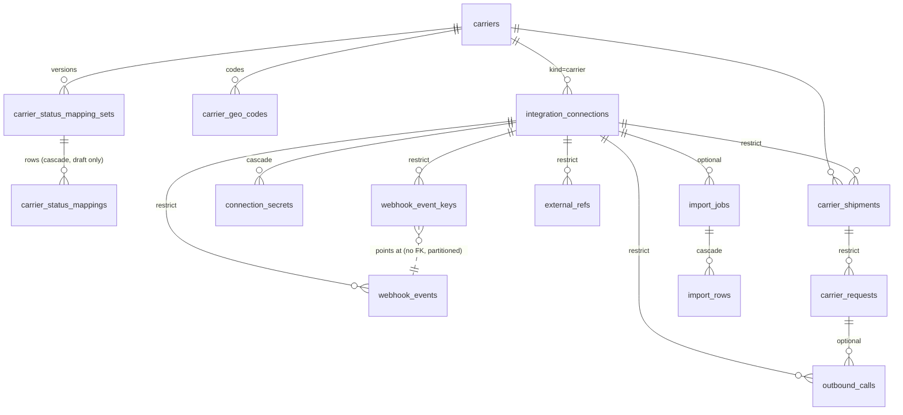

# integrations — data design

Status: **Proposed** (Phase 2 gate). DB `integrations` · Svc dir `Integrations` · milestone M4.
DDL: `src/Services/Integrations/Integrations.Infrastructure/Database/migrations/V0001__initial.sql` · seed `seed/S0001__carriers.sql` ·
tests `tests/T0001..T0004`. Building blocks C0001 + C0002 + **C0003 (geo)**. Validated on PostgreSQL 18.7 (docker `minicrm-pg`, 2026-11-20).

## 1. Purpose and ownership

Owns the anti-corruption layer to third parties (spec §1.3 #7, §5.8; v0.2 §2.2, §8): connections and their secrets,
the inbound **event inbox** (webhooks and polling), the **ID crosswalk**, **carrier vocabularies and geo codes** (gap G5),
idempotent **carrier operations**, **CSV/XLSX imports**, and a short-lived outbound **call log**.

Does **not** own: shipments and their state machine, `shipment_events`, return cases (→ orders; integrations only emits
our vocabulary); contacts/orders/products (→ crm/orders, created from our normalised events); `message_templates`,
conversations, messages (→ messaging, gap G6; WhatsApp template registration goes through integrations by event);
`api_keys` (→ identity-access, v0.2 §2.2); notifications (→ messaging, ADR-0005).

## 2. Table catalogue

| Table | Spec table(s) | Scope | Append-only | Partitioned |
|---|---|---|---|---|
| `carriers` | (new) carrier catalogue; spec `shipments.carrier` enum | platform, app SELECT only | no | no |
| `carrier_status_mapping_sets` | `carrier_status_mappings` (versioning) | platform | no | no |
| `carrier_status_mappings` | `carrier_status_mappings` | platform | frozen once set ≠ draft (trigger) | no |
| `carrier_geo_codes` | (new) CLAUDE.md §7, ADR-0005 | platform | no | no |
| `integration_connections` | `integration_connections` | tenant | no | no |
| `connection_secrets` | `integration_connections.credentials_encrypted`, `webhook_secret_hash` | tenant | no | no |
| `webhook_events` | `webhook_events` | tenant | yes (processing columns whitelisted) | monthly `received_at` |
| `webhook_event_keys` | `webhook_events` UNIQUE (connection_id, external_event_id) | tenant | no (purged) | no |
| `external_refs` | `external_refs` | tenant | no | no |
| `carrier_shipments` | carrier-side part of `shipments` (tracking, polling) | tenant | no | no |
| `carrier_requests` | (new) idempotent carrier calls | tenant | no | no |
| `import_jobs` | `import_jobs` | tenant | no | no |
| `import_rows` | (new) per-row results of `import_jobs` | tenant | no | no |
| `outbound_calls` | (new) spec §9 "integration health" debugging | tenant | yes | monthly `started_at` |

Plus `app.*` from C0001/C0002 (outbox, inbox, audit_log, files, tenants) and `ref.*` from C0003.
Functions: `resolve_webhook_connection`, `ingest_webhook_event`, `claim_webhook_events`, `claim_carrier_requests`,
`claim_shipments_to_poll`, `purge_webhook_event_keys` (all but `ingest` are SECURITY DEFINER; see §8).

## 3. ERD

Notes: `carrier_geo_codes` → `ref.wilayas` / `ref.communes` / `ref.geo_datasets` (FK, same DB). `import_jobs.file_id`,
`carrier_shipments.label_file_id` → `app.files` (FK, same DB). Opaque refs (no FK): `business_id`, `created_by`
(identity_access), `external_refs.entity_id` / `import_rows.entity_id` (crm.contacts, orders.orders/products/shipments),
`carrier_shipments.shipment_id` / `order_id` (orders), `carrier_requests.source_event_id` (orders outbox).
Every tenant child uses a **composite FK `(business_id, connection_id)`**, so a row can never point at another tenant's parent.

## 4. Deviations from the spec

| # | Deviation | Why | Winner |
|---|---|---|---|
| D1 | `carrier_status_mappings` lives here, versioned through `carrier_status_mapping_sets` (one `active` per carrier; published sets frozen by trigger) | Gap G5: no carrier vocabulary in the domain; reproducibility of normalised history | CLAUDE.md §7 + v0.2 §2.2 over spec §4.6 |
| D2 | `provider` split into `kind` (manual/csv/custom_api/shopify/whatsapp/carrier) + `carrier_code` FK → `carriers` | Carrier list is data (CLAUDE.md §14 "never hard-code"); v0.2 adds Maystro/Ecotrack/E-com | v0.2 §8 |
| D3 | `credentials_encrypted` / `webhook_secret_hash` → `connection_secrets` (secret-store ref **or** envelope blob + `kek_id`, or SHA-256 only for bearer tokens) | An HMAC key (Shopify, ZR) cannot be stored as a hash, the service must recompute the signature; rotation needs ≥ 2 live secrets | security; spec intent kept |
| D4 | UNIQUE (connection_id, external_event_id) enforced in `webhook_event_keys`, not on `webhook_events` | Partitioned table: uniques must include `received_at`, which differs per redelivery. Window = 90 days (§7) | conventions §6 + spec §4.10 |
| D5 | `webhook_events` gets `channel` (webhook/poll/replay), `external_id_kind` (provider/derived), `next_attempt_at`, `lease_until`, `ignored_reason`, `headers`, `payload_sha256` | Polling uses the same inbox; carriers without event ids get a derived key; leases for competing workers | spec §5.8.1 (pull fallback, retries) |
| D6 | Invalid/missing signatures are stored as `ignored` (CHECK) and take **no** dedup key | A forged request must not take the event id ahead of the genuine one (T0003) | spec "stored but never processed" |
| D7 | Status vocabulary: 13 values (adds `awaiting_customer_pickup` for stop-desk) + `unknown` on `carrier_shipments` only | Spec names no list; skill vocabulary + Algerian stop-desk flow. Contract with orders (Q1) | `[Likely]` |
| D8 | `import_jobs` status adds `validated` (dry-run done, waiting for commit) and `cancelled`; `rows_skipped`, `dedupe_strategy`; new `import_rows` | Spec §5.8.2 requires dry-run + error report; skip/update/create strategy | spec §5.8.2 |
| D9 | `import_jobs` stays in **integrations**, not crm | v0.2 §2.2 lists "imports" under integrations; crm/orders receive normalised events like any other adapter. **crm must not create import tables** (coordination note) | v0.2 over spec grouping |
| D10 | `api_keys`, `message_templates` not here | v0.2 §2.2 (identity-access), gap G6 (messaging) | v0.2 |
| D11 | Global uniques without `business_id` first: `webhook_route_key`, `(kind, carrier_code, external_account_id)` live; worker-claim indexes `(next_attempt_at)`/`(next_poll_at)` | Resolved **before** a tenant is known / scanned cross-tenant by workers; a business_id-first index cannot serve them. Sharding: route lookup becomes a small routing table on the coordinator | justified exception to conventions §2 |
| D12 | `external_refs.entity_id` NOT NULL, allocated by integrations (UUIDv7) on first sight | Redeliveries reuse the same id → owner's create is idempotent | spec §5.8.1 idempotency |

## 5. Indexes ↔ queries

| Index | Query / consumer |
|---|---|
| `uq_ic_route_key` | `resolve_webhook_connection(route_key)`: public webhook endpoint `/webhooks/{kind}/{route_key}` |
| `ux_ic_external_account` (partial, live) | `resolve_webhook_connection(kind, account)`: app-level webhooks (WhatsApp `phone_number_id`, Shopify shop domain); also prevents routing ambiguity |
| `uq_ic_business_id` | target of composite FKs; Integrations screen list per tenant (prefix `business_id`) |
| `ix_cs_live` | adapter loads live secrets of a connection by purpose (verify webhook, call API) |
| `ix_we_pending` (spec §4.10 partial `status='pending'`) | health card: queue depth and oldest pending per connection |
| `ix_we_claim` (partial pending/failed) | `claim_webhook_events` inbox worker (FOR UPDATE SKIP LOCKED) |
| `ix_we_connection` | Integrations screen: events of a connection by status, newest first; replay of failed/dead |
| `pk_webhook_event_keys` | dedup in `ingest_webhook_event` (ON CONFLICT) |
| `ix_wek_first_received` | `purge_webhook_event_keys` daily job |
| `uq_er_external` (spec §4.10) | inbound: "do we know Shopify order X?" (upsert path) |
| `ix_er_entity` | outbound write-back: our order → Shopify id (status tag/note), contact → WhatsApp id |
| `uq_cship_shipment` | consumer of `orders.shipment.requested` / cancel: find or create the carrier shipment |
| `ux_cship_tracking` | inbound carrier event (tracking number) → our `shipment_id` |
| `ix_cship_poll` | `claim_shipments_to_poll` polling fallback for non-terminal parcels |
| `uq_creq_idempotency` | `INSERT … ON CONFLICT DO NOTHING` per operation key (no double parcel) |
| `ix_creq_claim` | `claim_carrier_requests` dispatcher (pending, retryable, outcome_unknown) |
| `ix_creq_shipment` | shipment detail / support: operations of one parcel |
| `ix_ij_list` | Imports screen (tenant jobs, newest first) |
| `uq_ir_row`, `ix_ir_job_status` | idempotent row staging; progress counters; error-report export (`status IN invalid/failed`) |
| `ix_oc_connection` | connection debug drawer: last calls |
| `ux_csms_one_active`, `uq_csm_set_raw` | adapter loads the active mapping of a carrier; raw → normalised lookup |
| `ux_cgc_*_current`, `ix_cgc_inbound` | create parcel (our commune → carrier value); inbound address/commune resolution |

## 6. Events

Produced (written to `app.outbox` in the same transaction as the table change; names provisional until Phase 3):

| Event | Written when | Tables |
|---|---|---|
| `integrations.shipment.created` | carrier accepted parcel | `carrier_shipments` (created, tracking), `carrier_requests` (succeeded) |
| `integrations.shipment.creation_failed` | permanent failure / attempts exhausted | `carrier_requests`, `carrier_shipments` (failed) |
| `integrations.shipment.status_changed` | new normalised carrier status (webhook or poll); carries raw status, `mapping_version`, provenance `carrier_api` | `webhook_events` (processed), `carrier_shipments.last_*` |
| `integrations.contact.upserted`, `integrations.order.received`, `integrations.product.upserted` | Shopify / custom store / CSV row normalised | `webhook_events` or `import_rows`, `external_refs` |
| `integrations.message.received`, `integrations.message.status_changed` | WhatsApp inbound | `webhook_events`, `external_refs` |
| `integrations.connection.status_changed` | connection active/error/disabled (owner notification) | `integration_connections` |
| `integrations.import.completed` | job done/failed | `import_jobs` |

Consumed (idempotent via `app.inbox` (event_id, consumer) + natural keys above): `identity.business.*` → `app.tenants`;
`orders.shipment.requested` / `orders.shipment.cancel_requested` → `carrier_shipments` + `carrier_requests`;
`orders.order.*` → Shopify/custom write-back (`external_refs` lookup); `messaging.message.send_requested` → WhatsApp send;
`crm.contact.*` / `orders.order.placed` echoing our allocated id → `import_rows.status = succeeded`.

## 7. Partitioning and retention

| Table | Policy |
|---|---|
| `webhook_events` | monthly by `received_at`; payload holds customer PII → drop partitions older than **3 months** `[Guessing]` (no archive). Partitions are created and locked by `app.ensure_monthly_partitions` (C0001 `app.lock_partitions`) |
| `webhook_event_keys` | **dedup window = 90 days** (`purge_webhook_event_keys`, minimum 30). Longer than known retry horizons (Shopify ~48 h, Meta up to 7 days `[Likely]`) and equal to the event retention. A redelivery after the window is accepted again; handlers remain idempotent via `external_refs`, `uq_cship_*` and orders' version guards (T0003 case 5) |
| `outbound_calls` | monthly by `started_at`; drop partitions whose month ended > 1 month ago (30–61 days) |
| `import_rows` | delete rows 30 days after the job finishes (raw PII); `import_jobs` kept 1 year (counts only) `[Guessing]` |
| `carrier_requests.request_payload` | set NULL 30 days after `completed_at` (recipient PII); rows kept with the shipment |
| platform tables, connections, secrets, refs, carrier_shipments | kept; connections are disabled, never deleted (RESTRICT) |

## 8. Security notes

- RLS (`app.enable_tenant_rls`) on all 10 tenant tables; T0001 checks each with a generic helper and fails if a new
  business_id table lacks forced RLS. Partitions: runtime role holds **no** privilege on them (C0001 `lock_partitions`);
  T0001 asserts it for `public` and `app` partitions and that a direct partition read is refused.
- **Tenant from the connection.** The public webhook endpoint calls `resolve_webhook_connection` (SECURITY DEFINER,
  owner `integrations_migrator` with BYPASSRLS) which returns only ids + status for a 128-bit route key or a provider
  account id. The handler then sets `app.business_id` transaction-locally, loads secrets under RLS, verifies the
  signature and calls `ingest_webhook_event` (SECURITY INVOKER, refuses without tenant).
- Worker claim functions are SECURITY DEFINER and return **ids and business_id only** (no payload); the worker then
  processes each item in its own transaction under that tenant. `search_path` is pinned; EXECUTE revoked from PUBLIC.
- Secrets: never plaintext. `secret_store` = reference only; `envelope` = AEAD ciphertext + wrapped DEK + `kek_id`
  (AES-256-GCM or ChaCha20-Poly1305); `sha256_hash` only for high-entropy bearer tokens (plain SHA-256, 32 bytes,
  CHECK). Never returned by an API, never logged; `display_hint` ≤ 8 chars for the UI.
- PII columns: `webhook_events.payload/headers`, `carrier_requests.request_payload`, `import_rows.raw`,
  `outbound_calls.*_excerpt` (scrubbed, ≤ 4 KB, path templates without query strings). No phone columns: phones only
  transit inside payloads; crm/orders own normalised `phone_e164` + `phone_hash`.
- Platform tables: runtime role SELECT only (T0004); writes by migrator now, platform-admin role at M5.

## 9. Open questions

1. [Likely] Normalised shipment status vocabulary (13 values incl. `awaiting_customer_pickup`) is a contract with orders;
   fix it in the Phase 3 event catalogue and keep both CHECKs identical.
2. [Guessing] Carrier capabilities, status vocabularies, geo code lists, webhook signing schemes — all unverified (R3).
   Nothing seeded beyond carrier names; mappings and geo codes load from sandbox-verified sources.
3. Spec `outcome_class` has no `carrier_failure` although spec §1.3 #5 separates carrier fault. Add it (scoring
   decides weight) or map to `business_failure`? Needs scoring + orders agreement.
4. Ecotrack hosts several carriers: one `carriers` row per hosted carrier (api_family `ecotrack`) or one row + config?
5. Contact imports: when crm dedups to an existing contact, it must echo our allocated id with the resolved contact id
   so `external_refs.entity_id` / `import_rows.entity_id` can be corrected (event shape in Phase 3).
6. Signed **outbound** webhooks to custom stores (spec §5.8.2): subscriptions + delivery queue are V1 scope but not in
   this V0001. Proposed V0002 `outbound_webhook_subscriptions` / `outbound_webhook_deliveries` here, when that slice is planned.
7. [Guessing] Retention numbers (3 months events, 90-day dedup, 30 days rows/payloads) need legal review (law 18-07, R1).
8. Carrier stop-desk lists (`list_stopdesks`): cache in a table `carrier_stop_desks` or fetch live?
9. Carrier remittance files (cash reconciliation) — if imported through the import wizard, add `import_type = 'remittances'`;
   reconciliation itself stays in orders.

## 10. Requests to building blocks

1. ~~Partitions do not inherit RLS / privileges~~ — **fixed** in C0001 (`app.lock_partitions`, called by
   `app.ensure_monthly_partitions`); this service keeps a regression assertion in T0001.
2. `app.ensure_daily_partitions` (or a granularity parameter) so short-retention logs (`outbound_calls`) can drop
   by day instead of keeping 30–61 days.
3. `ref.communes`: add `UNIQUE (dataset_version, code, wilaya_code)` so consumers can FK a (commune, wilaya) pair
   consistently; today carrier commune rows store only the commune code.
4. A shared pattern/helper for "narrow SECURITY DEFINER claim function" (the same shape will appear in every service
   with cross-tenant workers: messaging, orders' timers).
