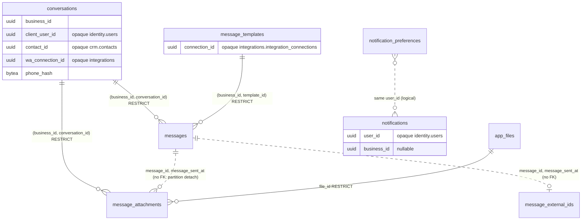

# messaging — data design (database `messaging`, M5)

Status: **Proposed** (Phase 2 gate). DDL: `src/Services/Messaging/Messaging.Infrastructure/Database/migrations/V0001__initial.sql`.
Tests: `.../Database/tests/T0001__rls_tenant_and_client.sql`, `T0002__append_only_and_constraints.sql` (pass on PostgreSQL 18.7).
Sources: V1 spec §1.3, §4.2, §4.7 (`message_templates`), §4.8 (`conversations`, `messages`), §4.9 (`notifications`), §5.9, §7.2,
§8.3 · v0.2 §2.2, §3.3–3.4 · ADR-0002, 0003, 0005 · gap G6.

## 1. Purpose and ownership

Owns: the unified inbox (business ↔ client threads over **in-app** chat or **WhatsApp**), messages and their delivery state,
WhatsApp template definitions (gap G6: moved from integrations), the per-channel consent state checked before sending, and
platform **notifications** + preferences (ADR-0005). The real-time hub (WebSocket/SSE) keeps no state in the DB.

Does NOT own: contacts and the interaction timeline (crm, fed by `messaging.message.received`), provider connections, webhooks
and the actual WhatsApp API calls (integrations), consent records of record (scoring `consents`; we keep a read model),
users/members/e-mail addresses (identity-access), reports/moderation queue (presence `reports`, target `conversation`).

## 2. Table catalogue

| Table | Spec table | Scope | Append-only | Partitioned |
|---|---|---|---|---|
| `conversations` | §4.8 conversations | tenant + client path | no (aggregate, `version`; no DELETE) | no |
| `messages` | §4.8 messages | tenant + client path | yes, except delivery state + redaction | monthly by `sent_at` |
| `message_external_ids` | (messages.external_message_id dedup) | tenant | yes | no |
| `message_attachments` | (messages.attachment_file_ids) | tenant + client path | yes | no |
| `message_templates` | §4.7 message_templates | tenant | no (aggregate, `version`) | no |
| `channel_consent_states` | — (read model of scoring consents + local STOP) | tenant | no (read model, `source_version`) | no |
| `notifications` | §4.9 notifications | **recipient user** | no (read/sent state flips; no DELETE) | no |
| `notification_preferences` | §5.9 (no spec table) | **recipient user** | no | no |
| `app.outbox/inbox/audit_log/files/tenants` | building blocks (C0002) | — | — | as C0002 |

## 3. ERD (inside this service)

## 4. Deviations from the spec

| # | Deviation | Why / source that wins |
|---|---|---|
| D1 | `message_templates` lives here, not in integrations | gap G6, v0.2 §2.2 (> spec) |
| D2 | `messages.attachment_file_ids uuid[]` → table `message_attachments` with FK to `app.files` | an array cannot carry an FK; the client RLS path needs a row to key on |
| D3 | `messages.external_message_id` uniqueness moved to `message_external_ids` (global PK) | a UNIQUE on a partitioned table must include `sent_at`, so it would not catch a webhook redelivery landing in another month |
| D4 | `messages.status` adds `pending` (outbound waiting for provider ack via integrations) | async send through integrations (v0.2 §3.4); spec values kept |
| D5 | `contact_id` nullable | crm links/creates the contact asynchronously from `messaging.message.received` (ADR-0002); inbox shows the phone/client until linked |
| D6 | WhatsApp threads carry `phone_raw/phone_e164/phone_hash` + `wa_connection_id` | needed to route inbound messages and to address replies; conventions §2 phone triple |
| D7 | Counters `client_message_count`, `member_message_count`, unread counters, `blocked_at/by` | spec §7.1(b) eligibility (≥2 client messages + ≥1 reply) and §7.2 unread badges / block |
| D8 | `message_templates.purpose` adds `review_request`; new `consent_purpose` (transactional/marketing) | spec §7.1 review invitation by WhatsApp template; consent per purpose (crm-marketing-campaigns) |
| D9 | `notifications` RLS is by **recipient** (`app.user_id`), not by tenant; business_id is nullable and therefore not first in indexes | spec §4.9 `business_id NULL` (client/platform notifications); a member must not see a colleague's notifications |
| D10 | `notifications` adds `delivery_status/attempts/claimed_until/last_error/source_event_id` | e-mail dispatch with retries; spec only has `sent_at` |
| D11 | `notification_preferences` table (no spec table) | spec §5.9 "per-user preferences for channel per event type" |
| D12 | `channel_consent_states` (new) | WhatsApp only through approved templates (§5.9); opt-out must block sends immediately; consents are owned by scoring (v0.2 §2.2) |

## 5. Indexes ↔ queries

| Index | Query / screen |
|---|---|
| `ux_conversations_in_app_client` (business_id, client_user_id) WHERE in_app | spec partial UNIQUE; "Message" button finds-or-creates the thread |
| `ux_conversations_whatsapp_phone` (business_id, wa_connection_id, phone_hash) WHERE whatsapp | inbound WhatsApp consumer: route message to thread |
| `ix_conversations_inbox` (business_id, status, last_message_at DESC) | unified inbox list (open/closed tabs) |
| `ix_conversations_assignee` (business_id, assigned_member_id, last_message_at DESC) | inbox for `assigned_only` staff |
| `ix_conversations_contact` (business_id, contact_id) | contact page "conversations"; crm.contact.merged relink |
| `ix_conversations_client` (client_user_id, last_message_at DESC) | client area "Messages" across businesses — **not business-first by design** (cross-tenant by nature) |
| `ix_messages_thread` (business_id, conversation_id, sent_at DESC) | thread view (staff + client), keyset pagination; also serves the client RLS EXISTS |
| `ix_messages_pending` (business_id, sent_at) WHERE pending | outbound send/retry loop |
| `pk_message_external_ids` | webhook dedup + status callback (`wamid` → message) |
| `uq_message_attachments_pos`, `ix_message_attachments_file` | attachments of a message; app.files client policy lookup |
| `ix_message_templates_purpose` WHERE approved | template picker at send time |
| `pk_channel_consent_states` | pre-send consent check per (phone_hash, channel, purpose) |
| `ix_notifications_user`, `ix_notifications_unread` | bell dropdown, unread badge |
| `ix_notifications_email_queue` WHERE email pending/sending | `claim_email_notifications()` |
| `ix_notifications_created` (BRIN) | retention purge by age |

## 6. Events

Produced (via `app.outbox`, same transaction):
- `messaging.message.received` (inbound client/WhatsApp message; payload: conversation_id, message_id, channel, contact_id?,
  client_user_id?, phone_hash?, sender_type, counts) → crm (timeline + contact link), notifications fan-out (this service).
- Proposed: `messaging.message.sent` (outbound, for the crm timeline), `messaging.template.submitted` (integrations registers it
  with the provider), `messaging.whatsapp.send_requested` (integrations sends), `messaging.opt_out.received` (scoring records
  consent), `messaging.conversation.review_eligible` (presence; see open question 2). Names to be fixed in Phase 3.

Consumed (inbox `app.inbox`, tenant from envelope):
- integrations inbound WhatsApp message / status / template decision → `conversations`, `messages`, `message_external_ids`, `message_templates`.
- `crm.contact.created/updated/merged` → `conversations.contact_id`, `contact_display_name`.
- `scoring.consent.changed` → `channel_consent_states` (version guard on `source_version`).
- Notification triggers (spec §5.9): `orders.order.confirmed/cancelled`, `orders.order.delivered/refused/returned`,
  `presence.review.posted`, `identity.invitation.*`, `integrations.connection.error`, `scoring.dispute.*`,
  `scoring.consent.changed` → `notifications` (fan-out sets `app.user_id` per recipient).
- `identity.business.*` → `app.tenants` (refuse writes for suspended tenants).

## 7. Partitioning and retention

| Table | Partitioning | Retention [Guessing until legal R1] |
|---|---|---|
| `messages` | monthly RANGE `sent_at`, 3 months ahead, DEFAULT safety net | keep 24 months online, then detach + archive; erasure = redaction in place |
| `message_external_ids` | none | delete rows older than the message archive horizon (maintenance job) |
| `notifications` | none (moderate volume) | in-app read > 90 days and e-mail sent > 30 days deleted by maintenance job |
| `conversations`, templates, consents, prefs | none | lifetime of tenant; consent states never purged while the tenant exists |

## 8. Security notes

- **Two RLS paths.** Staff: `tenant_isolation` (`app.business_id`). Client: `client_*` policies keyed by
  `conversations.client_user_id = current_user_id()` (setting `app.user_id`, transaction-local). Policies are permissive and
  OR-ed, so a person who is both staff and client sees the union of what each role allows. Messages/attachments use an EXISTS
  on the client's conversation (covered by `ix_messages_thread` + PK).
- Client writes are limited: insert `in_app` threads for themselves only (no assignee/blocked), insert `sender_type='client'`
  messages only into their own open, non-blocked thread, update only read markers/counters (`guard_client_update` trigger) and
  delivery state of messages (column grants from `make_append_only`). Tested in T0001.
- Partitions of `messages` (and of the C0002 tables) are locked by `app.lock_partitions`: the runtime role, on the staff or client
  path, gets `insufficient_privilege` on any direct partition read/insert (T0001 §4b); data is reachable only through the parent.
- `app.files` gets two extra permissive policies for `purpose='attachment'` (uploader = client, or file attached in the client's
  thread) — local workaround, request R2.
- `notifications`/`notification_preferences`: RLS by recipient; inserts must also match the current tenant or be platform rows.
  The e-mail dispatcher uses `claim_email_notifications()` / `complete_email_notification()` (SECURITY DEFINER, owner is the
  BYPASSRLS migrator, fixed `search_path`, returns only sender columns).
- PII: `phone_raw/phone_e164`, `contact_display_name`, `messages.body`, `template_params`. Erasure = `body/template_params → NULL`
  + `redacted_at` (only change allowed besides delivery state; irreversible). `phone_hash` = HMAC-SHA256 with the pepper from the
  secret store (computed in app). No tokens or secrets stored.

## 9. Open questions

1. [Likely] Should a **client** be able to block/report a thread? Today only staff/web_master can set `blocked_*`; client reports go to presence `reports`.
2. Review eligibility (b) needs messaging → presence: a dedicated `messaging.conversation.review_eligible` event (emitted when
   client ≥ 2 and member ≥ 1) or presence counting `message.received`? Not in v0.2's catalogue. [Guessing: dedicated event]
3. STOP keyword scope: marketing only, or also transactional (order confirmation) messages? Provider rules unverified. [Guessing: marketing only]
4. Who maintains `notifications` retention and partition jobs (which DB identity)? Assumed the same maintenance job identity as `ensure_monthly_partitions`.
5. E-mail address of a recipient: gRPC to identity-access at send time or a local read model? Not stored here yet.
6. "Owners always receive integration errors" (§5.9) needs the member role: from the `identity.member.changed` read model (not designed here) or the event payload.
7. web_master review of reported threads (break-glass) needs the platform-admin role `messaging_admin` (convention §1, M5).

## 10. Requests to building blocks

- **R1** Add `app.current_user_id()` (setting `app.user_id`) to C0001; messaging and presence both define `public.current_user_id()` locally today.
- **R2** `app.files` policy for non-tenant uploaders (client attachments). Messaging adds a local permissive policy on `app.files`.
- **R3** `app.forbid_update_except()` should ignore generated columns (in BEFORE UPDATE, NEW.generated is NULL, so any STORED
  generated column reads as "changed"). Messaging dropped a generated `direction` column to work around it.
- **R4** Bootstrap the `<db>_admin` platform role (web-master console, M5) so moderation/break-glass policies can target it.
