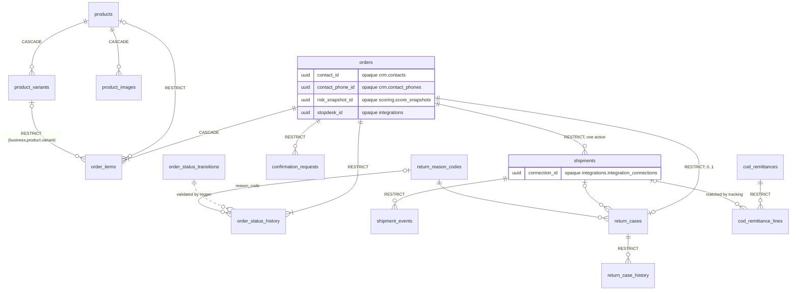

# orders — database schema (db `orders`)

Status: **Proposed** (Phase 2). Files: `src/Services/Orders/Orders.Infrastructure/Database/{migrations/V0001__initial.sql,
seed/S0001__order_status_transitions.sql, seed/S0002__return_reason_codes.sql, tests/T0001..T0004}`.
Applied after C0001, C0002, C0003 (geo). Validated on PostgreSQL 18.7 (Docker `minicrm-pg`) with
`tools/db/bootstrap-service-db.sh orders Orders --geo --reset` → `OK orders`.

## 1. Purpose and ownership

**Owns** (v0.2 §2.2, "order, shipment and return change together"): catalogue (products, variants, images), orders
and lines, the **order state machine** and the **separate cash (COD) state machine** with their append-only history,
confirmation links, shipments in **our** normalised vocabulary, shipment events, COD remittance reconciliation,
return cases with fault attribution, order numbering, risk-policy rules, delivery-fee defaults.

**Does not own**: contacts/phones (crm), scores, signals, consents (scoring), carrier accounts, carrier status codes,
raw webhook payloads, carrier tariffs and stop-desk catalogue (integrations), users/members/permissions
(identity-access), geography (shared `ref` reference data, C0003). It never computes the score: it *reads* tier +
confidence and emits facts (`orders.order.delivered`, …) that scoring turns into signals.

## 2. Table catalogue

| Table | Spec source | Scope | Append-only | Partitioned |
|---|---|---|---|---|
| `products` | §4.6 products | tenant | no (soft delete; DELETE revoked) | no |
| `product_variants` | §4.6 product_variants | tenant | no | no |
| `product_images` | §4.6 product_images | tenant | no | no |
| `orders` | §4.6 orders (+ cash_status replacing payment_status) | tenant | no (DELETE revoked) | no |
| `order_items` | §4.6 order_items | tenant | no | no |
| `order_status_history` | §4.6 order_status_history (order **and** cash machine) | tenant | **yes** | monthly, `recorded_at` |
| `order_status_transitions` | §5.5 table, §5.7, cash per algeria-cod-crm | platform, read-only | n/a (seed) | no |
| `confirmation_requests` | §4.6, §5.6 | tenant | no (DELETE revoked) | no |
| `shipments` | §4.6 shipments | tenant | no (DELETE revoked) | no |
| `shipment_events` | §4.6 shipment_events | tenant | **yes** (anomaly resolution cols whitelisted) | monthly, `occurred_at` |
| `cod_remittances` | — [Likely] algeria-cod-crm `remittance_batch` | tenant | no (DELETE revoked) | no |
| `cod_remittance_lines` | — [Likely] `remittance_line` | tenant | no (DELETE revoked) | no |
| `return_reason_codes` | §4.6 return_reason_codes | platform, read-only | n/a (seed) | no |
| `return_cases` | §4.6, §5.7 | tenant | no (DELETE revoked) | no |
| `return_case_history` | §5.7 "justification stored", CLAUDE.md §7 | tenant | **yes** | no (low volume) |
| `order_settings` | §8.4 Settings (order numbering), §5.5/5.6 knobs | tenant | no | no |
| `order_number_counters` | §4.6 "sequence-based" | tenant | no | no |
| `risk_policy_rules` | §6.4 `risk_policy` | tenant | no | no |
| `delivery_fee_rates` | — [Likely] merchant fee defaults (home vs stop-desk) | tenant | no | no |
| `rm_contacts`, `rm_contact_phones` | read model of `crm.contact.*` | tenant | no | no |
| `rm_score_tiers` | read model of `scoring.score.updated` | tenant | no | no |

22 tables (20 tenant + 2 platform reference). All tenant tables: `business_id` + `app.enable_tenant_rls`.

## 3. ERD (inside this service)

Every intra-service FK is **composite `(business_id, parent_id)`** against `UNIQUE (business_id, id)`: FK checks
bypass RLS, so a single-column FK would let tenant B attach a child to tenant A's order (tested in T0001).
External FKs inside the same DB: `ref.wilayas`/`ref.communes` (geo, versioned) and `app.files` (evidence, labels, images).

## 4. Deviations from the spec

1. **`payment_status` → `cash_status` + `payments` dropped.** CLAUDE.md §7 / algeria-cod-crm: delivery and cash are
   separate machines; spec values (unpaid/cod_pending/collected/refunded_mock) cannot express carrier remittance.
   Cash machine: `pending_collection → collected_by_carrier|collected_by_business → remitted → reconciled`, plus
   `disputed`, `not_collected`, `written_off`, `refunded`, `not_applicable` (mock card/bank). Spec `payments` was a
   mockup table; collection facts now live in `cash_status` + history + remittance lines. CLAUDE.md wins (spec is
   silent on remittance); the mock-payment UI needs no table (Open Q3).
2. **`carrier` text, `status_raw`, `payload` removed from shipments/shipment_events**; `carrier_status_mappings` not
   here. Gap G5 / CLAUDE.md §7: no carrier vocabulary in orders; integrations maps and sends our status.
   `shipment_events.integration_event_id` points back to the raw payload. v0.2 + G5 win.
3. **FKs to other services → opaque uuids** (contact, contact_phone, opportunity, users, consents, score snapshot,
   connection, stop-desk). ADR-0002. Contact data is **snapshotted** on the order (name, phone raw/E.164/hash, address
   with `geo_dataset_version`). `contact_id` is nullable: store/webhook orders arrive before crm creates the contact (Open Q1).
4. **`order_status_history` also logs the cash machine** (`machine` column) and adds `order_version`, `provenance`,
   `is_override`, `reason_code`, `recorded_at` (partition key). One log keeps "who/what/when/source" for both machines.
5. **`external_event_id` is not unique in history.** A unique on a partitioned table must include the partition key;
   integration idempotency is enforced by `app.inbox` and `shipment_events (business_id, shipment_id, external_event_id, occurred_at)`.
6. **Order numbering**: `order_seq bigint` + display `order_number` (`prefix + zero-pad`), per-business counter (§7 below).
7. **`confirmation_requests.result` adds `superseded`** (link re-sent) and a partial unique "one open link per order".
   `token_hash` is `bytea` (SHA-256), not `text`.
8. **Extra columns on orders**: `idempotency_key`, `requires_manager_approval`/`manager_approved_*` (tier-D policy once
   applied), `risk_tier_at_order`/`risk_confidence_at_order`/`risk_recommended_actions`, `pii_erased_at`, `version`.
9. **Stock**: `reserved_qty` added (spec §5.5 side effects "reserved"/"released"); `stock_qty` has no floor (Open Q5).
10. **Added reason codes** `WRONG_NUMBER`, `NEVER_ORDERED` (fault `unknown`, weight 0 per §5.5.2), `PARCEL_LOST`,
    `BUSINESS_CANCELLED`, `OTHER`. Labels ar/fr/en are drafts [Likely].
11. **Tables not in spec**: `cod_remittances`/`_lines`, `delivery_fee_rates` [Likely], `return_case_history`,
    `order_settings`, `order_number_counters`, `risk_policy_rules` (spec has `risk_policy` as a business setting).
12. **PK exceptions to "id uuid PK"**: per-tenant singletons (`order_settings`, `order_number_counters`) and read models
    (`rm_*`) are keyed `(business_id, natural id)`; partitioned tables use `(id, partition_col)`.

## 5. State machines — how they are enforced (and why a table + triggers)

`order_status_transitions` holds one row per legal edge (`from_status NULL` = legal initial state), with
`allowed_sources` and `requires_reason`. Order edges are the §5.5 table verbatim (21 edges incl. 3 initial).
Two guards make an illegal transition impossible to commit:

1. **`trg_osh_validate`** (BEFORE INSERT on `order_status_history`): the edge must exist, the `source` must be allowed
   (e.g. `return_in_transit → returned` only `manual`: "agent must confirm"; carriers can never cancel), a reason code
   is required where §5.5.2 demands it (`→ delivery_failed`, `→ returned`, `delivered → return_in_transit`). Errors
   carry the UI codes `ORDER_ILLEGAL_TRANSITION`, `ORDER_ALREADY_TERMINAL`, `ORDER_TRANSITION_SOURCE_NOT_ALLOWED`,
   `ORDER_TRANSITION_REASON_REQUIRED`. Overrides (`is_override`) skip the edge check but need note + user + `manual`.
2. **`trg_orders_history_ins/upd`** (DEFERRABLE INITIALLY DEFERRED constraint triggers on `orders`): every value of
   `status` and `cash_status` (including the initial one) must have a history row with the same edge and
   `order_version = orders.version`, written in the same transaction → `ORDER_STATUS_CHANGE_NOT_LOGGED`. Deferred so
   EF Core may save the order and the history row in any order. `orders.version` must increase on every update.

Row-level CHECKs couple the machines: confirmed+ states need `confirmation_status='confirmed'` and a complete
destination (E.164 phone, dataset+wilaya+commune, address for home / desk for stop-desk); terminal states need
`outcome_class` and `closed_at`; `delivered` ⇒ `success` and cash no longer pending; cancelled ⇒ cash
`not_collected|not_applicable`; collected/remitted cash ⇒ order delivered (or returning after delivery).
Return cases use the same table (`machine='return'`) through a BEFORE UPDATE trigger.

**Why table + trigger, not hard-coded CHECK/CASE:** one data source the C# state machine, the order-detail stepper
("allowed next actions") and the DB all read; a contract test asserts C# == table. A CHECK can only validate values,
not edges (it cannot see OLD). Cost: one indexed lookup per transition, and the table is read-only for the app role
(changes only via reviewed seed). **Tested** (T0002): full happy path for both machines, 15+ refused transitions,
unlogged changes, wrong-version logs, override with/without note, expiry by system, return-case edges, and a
reachability check that every status is reachable and `returned`/`cancelled` are sinks. A mutated test was run to
prove the assertions bite. Deferred guards were also verified at a real `COMMIT` with a transaction-local tenant.

## 6. Order numbers (UNIQUE per business, gap-tolerant)

`allocate_order_numbers(n)` does one `INSERT … ON CONFLICT (business_id) DO UPDATE SET next_value = next_value + n
RETURNING` on `order_number_counters` for the **current tenant** (fails closed without one). The app calls it in its
**own short transaction** before the order transaction, so the row lock lasts microseconds and contention exists only
inside one tenant. Numbers are never reused; gaps appear when an order insert fails or a block (CSV import: `n = 500`)
is not fully used — acceptable because order numbers are not invoice numbers (invoicing is out of V1 scope).
Rejected: one global sequence (per-tenant numbers leak volume and are huge), a `SEQUENCE` object per tenant (runtime
DDL, app role cannot CREATE, catalogue bloat), `MAX()+1` (race or table lock), counter inside the order transaction
(gapless but serialises all order writes of a tenant for the transaction's length).

## 7. Indexes ↔ queries

| Index | Query / consumer |
|---|---|
| `ux_orders_number (business_id, order_number)` | spec §4.10; search by order number; uniqueness |
| `ux_orders_idempotency` (partial) | `POST /v1/orders` / webhook-created order retries |
| `ix_orders_status_placed (business_id, status, placed_at DESC)` | spec §4.10; Orders list by status, Call workbench queue, dashboard "to confirm", expiry job |
| `ix_orders_placed (business_id, placed_at DESC)` | Orders list without status filter |
| `ix_orders_contact` (partial) | spec §4.10; Contact detail → orders; `crm.contact.merged` re-pointing |
| `ix_orders_phone` (partial) | New-order duplicate warning (same phone within N h); tier join with `rm_score_tiers` |
| `ix_orders_cash_aging` (partial) | "delivered but not paid" aging per carrier; remittance matching |
| `ux_orders_tenant_id`, `ux_*_tenant_id` | targets of composite FKs |
| `ix_order_items_order`, `ix_order_items_product` | load order lines; RESTRICT check on variant delete; product analytics |
| `ix_osh_order (business_id, order_id, recorded_at)` | Order detail history; deferred "must be logged" check |
| `ux_confirmation_requests_token (token_hash)` **global** | public `/c/{token}` via `resolve_confirmation_token` (no tenant known yet) |
| `ux_confirmation_requests_open` (partial) | one open link per order |
| `ix_confirmation_requests_order`, `ix_confirmation_requests_due` | Order detail link status; per-tenant expiry job |
| `ux_shipments_tracking` (NULLS NOT DISTINCT, partial) | `integrations.shipment.*` consumer lookup; remittance matching by tracking |
| `ux_shipments_one_active` (partial) | one live delivery chain per order |
| `ix_shipments_order`, `ix_shipments_stale` | Order detail; polling fallback / "stuck parcel" alert |
| `ux_shipment_events_dedup`, `ix_shipment_events_timeline`, `ix_shipment_events_anomalies` | redelivery rejection; tracking timeline; spec §5.5.1 anomaly list |
| `ux_cod_remittances_reference`, `ix_cod_remittances_list` | idempotent batch import; remittance list |
| `ix_crl_*`, `ux_crl_settled_once` | batch detail / exceptions queue; shipment & order cash detail; a parcel is paid once |
| `ix_return_cases_list`, `ix_return_cases_shipment` | Returns screen (open cases); shipment → case |
| `ix_rch_case` | return-case timeline |
| `ux_products_sku`, `ix_products_list`, `ux_product_variants_sku` | SKU uniqueness (live rows); Products screen; CSV import upsert |
| `ux_risk_policy_rules`, `ux_delivery_fee_rates`, `ix_rm_contact_phones_contact` | policy lookup by tier; fee pre-fill; contact phone list |

Not indexed on purpose: wilaya/carrier/channel analytics (replica + materialised views, CLAUDE.md §4); trigram product
search (catalogue per tenant is small; `pg_trgm` GIN cannot lead with `business_id` without `btree_gin`).

## 8. Events

**Produced** (written to `app.outbox` in the same transaction): `orders.order.placed`, `.confirmed`, `.cancelled`,
`.delivered`, `.refused`, `.returned` (aggregate `orders`, version = `orders.version`; payload includes
`outcome_class`, `outcome_source`, `phone_hash`, fault for returns); `orders.shipment.requested` (shipments row
`requested`); `orders.return.received`; [Likely] `orders.return.fault_changed` (scoring must invalidate the earlier
signal, §5.7) and `orders.cash.status_changed` (dashboards/crm).

**Consumed** (idempotent via `app.inbox`; tenant from envelope; version guards):

| Event | Table(s) |
|---|---|
| `identity.business.*` | `app.tenants`; on created: default `risk_policy_rules` + `order_settings` |
| `crm.contact.created/updated/merged/erased` | `rm_contacts`, `rm_contact_phones`; merged → `orders.contact_id` re-pointed; erased → order snapshot anonymised (`pii_erased_at`) |
| `scoring.score.updated` | `rm_score_tiers` (tier + confidence only) |
| `integrations.shipment.created` | `shipments` (`requested → created`, tracking, label) or `creation_failed` |
| `integrations.shipment.status_changed` | `shipment_events` (+anomaly flag), `shipments`, `orders` + `order_status_history` (order/cash), `return_cases` |
| [Likely] `integrations.remittance.imported` | `cod_remittances`, `cod_remittance_lines`, cash transitions |

## 9. Partitioning and retention

| Table | Partition | Retention [Guessing until legal review] |
|---|---|---|
| `order_status_history` | monthly on `recorded_at` (deferred check prunes to the last day) | 5 years online (order disputes, score audit), then detach + archive |
| `shipment_events` | monthly on carrier `occurred_at` (redelivery hits the same partition → dedup) | 2 years online, then archive |
| `app.outbox` / `app.inbox` / `app.audit_log` | building block | per conventions |

Orders, returns, remittances: never deleted (spec §4.1); erasure anonymises the snapshot. Partitions are created by
`app.ensure_monthly_partitions` (daily job, as migrator) **after** RLS/append-only are set, and are locked by
`app.lock_partitions`; T0004 proves direct partition reads/inserts are denied, including partitions created later.

## 10. Security notes

- RLS on all 20 tenant tables (fail closed, tested in T0001 with a coverage guard that fails when a new RLS table has
  no test). Composite FKs stop cross-tenant children. DELETE revoked on orders/money/returns/products.
- **PII**: `orders.customer_name`, `phone_raw`, `phone_e164`, `address_text`, `address_notes`; `rm_contact_phones.phone_*`;
  `confirmation_requests.ip`, `user_agent`, `recap_snapshot`/`edits` (may contain address). `phone_hash` =
  HMAC-SHA256(pepper, E.164), computed in the app, pepper never in the DB.
- **Confirmation token**: 256-bit random, only `SHA-256(token)` stored (high entropy, so no pepper needed); single use
  (resolution returns nothing once `result` is set or the link expired). `resolve_confirmation_token` is the only
  `SECURITY DEFINER` function (`search_path` pinned, returns ids only); tested.
- Score data: only tier + confidence are cached; never reasons or signal counts (CLAUDE.md §5).

## 11. Open questions

1. [Likely] Who creates the contact for store/webhook orders, and when is `orders.contact_id` back-filled (crm consumes `orders.order.placed`?).
2. [Likely] Spec §5.5 has no `shipped → delivered` edge; carriers often skip "out for delivery". Should integrations synthesise it, or add the edge?
3. Mock card/bank payments (§1.2): is UI-only acceptable without a `payments` table?
4. [Likely] Remittance reconciliation and `delivery_fee_rates` are not in the V1 spec — confirm they are in V1 scope.
5. [Guessing] Allow negative stock (backorders) or `CHECK (stock_qty >= 0)`?
6. [Likely] Cash `refunded` edges for post-delivery returns (refund is cash in hand, not a gateway refund).
7. Where does the stop-desk catalogue live (integrations per carrier?) — `orders.stopdesk_id` is opaque until then.
8. WhatsApp "yes" reply → which event confirms the order (`integrations.whatsapp.reply_received`?) — source `webhook` is allowed.
9. Retention periods in §9 need the legal review (law 18-07).
10. Confidence vocabulary (`high/medium/low/not_enough_data`) must match scoring's contract.

## 12. Requests to building blocks

1. `app.files`: add `UNIQUE (business_id, id)` so services can use composite FKs to files (today `file_id` FKs are
   single-column; a tenant could reference another tenant's file id — RLS still hides it).
2. `ref.communes`: add `UNIQUE (dataset_version, code, wilaya_code)` so "commune belongs to wilaya" is a plain FK;
   today orders uses trigger `orders_check_geo`.
3. Document in conventions that CHECK constraint evaluation order is by name and that `IS NOT DISTINCT FROM` must be
   used in `col <> x OR other = y` CHECKs (two NULL-unsafe CHECKs were caught by the tests here).
