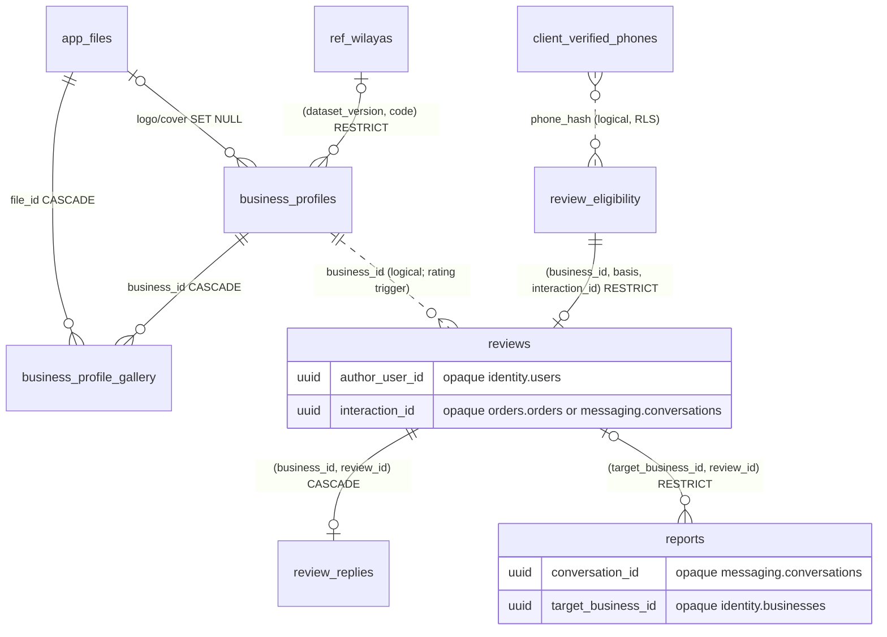

# presence — data design (database `presence`, M5)

Status: **Proposed** (Phase 2 gate). DDL: `src/Services/Presence/Presence.Infrastructure/Database/migrations/V0001__initial.sql`,
seed `seed/S0001__rating_parameters.sql`, tests `tests/T0001__rls_public_client_webmaster.sql`, `tests/T0002__constraints.sql`
(pass on PostgreSQL 18.7, bootstrapped with `--geo`).
Sources: V1 spec §1.3, §2 (clients reach only their rows), §4.2, §4.8, §4.10, §7.1, §7.3, §7.4, §8.3, §8.5 · v0.2 §2.2, §3.4 ·
ADR-0002, 0003, 0005.

## 1. Purpose and ownership

Owns the **public surface**: business profile pages (`/b/{slug}`), V1 discovery search (name, wilaya, category), reviews
(client → business only), the single business reply, the abuse/moderation **reports** queue for the web master, and the
Bayesian rating. Read-heavy and anonymous: built to be cached (Valkey keys `presence:{business}:profile`, invalidated by
profile/review events).

Does NOT own: the business itself (name, slug, status, verified badge, wilaya live in identity-access `businesses`; presence keeps a
copy), orders/deliveries (orders), conversations (messaging), public products (orders; `show_products` only toggles the section),
file bytes (`IFileStorage`).

## 2. Table catalogue

| Table | Spec table | Scope | Append-only | Partitioned |
|---|---|---|---|---|
| `business_profiles` | §4.8 business_profiles (+ copy of businesses name/slug/verified/wilaya/public contact) | tenant | no (aggregate `version` + `identity_source_version`) | no |
| `business_profile_gallery` | business_profiles.gallery | tenant | no | no |
| `review_eligibility` | — (§7.1 eligibility read model) | tenant + client read | no (read model, `source_version`) | no |
| `client_verified_phones` | — (read model of client_profiles phone verification, hash only) | platform, RLS by user | no (`source_version`) | no |
| `reviews` | §4.8 reviews | tenant read + author + web_master | no (no DELETE) | no |
| `review_replies` | §4.8 review_replies | tenant + author read | no | no |
| `reports` | §4.8 review_reports (generalised) | platform queue | no (no DELETE) | no |
| `rating_parameters` | — (§7.1 C and m) | platform singleton | read-only to runtime | no |
| `pub.business_profiles`, `pub.reviews` | views | anonymous | read-only | — |

No domain table is append-only: moderation decisions go to `app.audit_log` (append-only, C0002) in the same transaction.

## 3. ERD (inside this service)

## 4. Deviations from the spec

| # | Deviation | Why / source that wins |
|---|---|---|
| D1 | `business_profiles` carries a copy of `name, slug, verified_at, wilaya, public phone/email` from identity `businesses` | §7.3 page shows them; no cross-DB query (ADR-0002, v0.2 §2.4). `slug` UNIQUE here too (URL resolves locally) |
| D2 | Wilaya stored as `(wilaya_dataset_version, wilaya_code)` FK `ref.wilayas` | CLAUDE.md §7 versioned geo; C0003 |
| D3 | `rating_avg / rating_count` → `rating_sum / rating_count` + `rating_parameters`; Bayesian and raw averages computed in `pub.business_profiles` | m (platform mean) changes over time; storing the Bayesian value would need recomputing every profile. Formula = spec §7.1 |
| D4 | `reviews.order_id / conversation_id` are **generated** from `(basis, interaction_id)`; one-of CHECK kept explicit | spec §4.10 one-of becomes impossible to violate; lets a single composite FK reach the eligibility row |
| D5 | UNIQUE `(business_id, basis, interaction_id)` replaces `(author, order_id)` / `(author, conversation_id)` | one review per order/conversation (§7.1) — stricter; business-first rule (conventions §2) |
| D6 | `review_eligibility` + `client_verified_phones` read models (new) | §7.1 eligibility enforced **in the DB** (author insert policy) — v0.2 §3.4 "presence consumes order.delivered" |
| D7 | `review_reports` → `reports` covering review, business_profile, conversation; adds `reporter_business_id`, `resolution_note`, `resolved_*` | §7.2/7.3 "Report" actions and §8.5 single moderation queue. Spec statuses kept: open/dismissed/actioned |
| D8 | `gallery uuid[]` → `business_profile_gallery` rows | FK to `app.files`, ordering |
| D9 | `reviews.author_display_name`, moderation `moderated_at/by` | public page shows an author name without exposing the user id; who moderated (§8.5) |
| D10 | Business **cannot UPDATE** reviews at all (no tenant UPDATE policy) | §7.1 "Businesses cannot delete or hide reviews" |

## 5. Indexes ↔ queries

| Index | Query / screen |
|---|---|
| `uq_business_profiles_slug` | `/b/{slug}` profile page (anonymous, hottest read) — global by nature, not business-first |
| `uq_business_profiles_business` | every staff/consumer access by tenant; rating trigger |
| `ix_business_profiles_name_trgm` (GIN trgm) WHERE published | V1 search by name (§7.3) |
| `ix_business_profiles_wilaya` WHERE published | search filter by wilaya |
| `ix_business_profiles_categories` (GIN) WHERE published | search filter by category |
| `uq_business_profile_gallery_pos`, `ix_business_profile_gallery_file` | gallery order; FK cascade on file delete |
| `uq_review_eligibility_interaction` | consumer upsert (version guard); review FK target |
| `ix_review_eligibility_phone`, `ix_review_eligibility_client` | client Home "review your delivered orders" across businesses (not business-first: per-client by nature) |
| `ix_client_verified_phones_hash` | eligibility RLS join (phone → user) |
| `ix_reviews_business` (business_id, status, created_at DESC) | public review list; business "Reviews" screen |
| `ix_reviews_author` | client area "Reviews" (my reviews) |
| `uq_review_replies_review` | reply once; public join |
| `ux_reports_open_per_reporter` | one open report per reporter and target (anti-spam) |
| `ix_reports_queue` WHERE open | web master "Review moderation" queue |
| `ix_reports_target` | reports about one business/review; FK RESTRICT lookup |

## 6. Events

Produced (`app.outbox`): `presence.review.posted` (→ messaging notifications "review_posted"). Proposed for Phase 3:
`presence.review.edited`, `presence.review.moderated`, `presence.reply.posted`, `presence.profile.published/unpublished`
(cache invalidation, client notification), `presence.report.resolved`.

Consumed (`app.inbox`, tenant from envelope):
- `identity.business.created/updated/verified/status_changed` → `business_profiles` copy columns (guard `identity_source_version`) and `app.tenants` (status → public visibility).
- `orders.order.delivered` → `review_eligibility` basis order (needs `phone_hash`, order number in the payload; guard `source_version`).
- messaging conversation eligibility (open question 1) → `review_eligibility` basis conversation.
- identity client phone verified/removed (open question 2) → `client_verified_phones`.

## 7. Partitioning and retention

No partitioned domain table: volumes are small (one row per review/report). `app.outbox/inbox/audit_log` are partitioned by the
building blocks. Retention [Guessing, legal R1]: reviews kept while the business exists; on author erasure the review is
anonymised (`author_display_name` → "Client", `author_user_id` kept as pseudonymous id or set to a tombstone — open question 4);
resolved reports deleted after 24 months; eligibility rows of unreviewed orders purged after 12 months.

## 8. Security notes

- **Public path (anonymous).** Schema `pub` holds only views; the runtime role has SELECT on them and nothing else is public.
  The views run with the owner's rights (`presence_migrator`, BYPASSRLS), filter `is_published` + `app.tenants.status='active'`
  (suspended/closed/unknown businesses disappear) + `reviews.status='published'`, and project only public columns. Tested: base
  tables return 0 rows without context; `author_user_id`, `interaction_id`, `moderation_reason`, `rating_sum`,
  `identity_source_version` raise `undefined_column` through `pub`; views are not writable. `security_barrier` is not set because
  the runtime role has no TEMP/CREATE privilege (no user-defined leaky functions) and it would disable the trigram index.
- **Client path** (`app.user_id`, no tenant): sees eligibility rows matching its verified phone hash or its own conversations,
  its own reviews/replies/reports/phone link; inserts reviews only for a visible eligibility row (DB-enforced §7.1), edits only
  content of its own reviews (`edited_at` set by trigger). 7-day edit window [Guessing] is config, enforced in the handler.
- **web_master path** (`app.platform_role='web_master'` + `app.user_id`): reads all reviews/replies/reports, changes review status
  (hide/restore/remove with reason, `removed` terminal) and resolves reports. Only web_master can change moderation columns; even
  web_master cannot edit review content (guard trigger). A dedicated `presence_admin` role is preferable (R3).
- **Staff path** (`app.business_id`): manage its profile (no column grant on the rating aggregate), read its reviews, reply once,
  report; never sees reports about itself nor client phone hashes.
- `reviews_maintain_rating` and `refresh_rating_parameters` are SECURITY DEFINER with fixed `search_path`.
- PII: `reviews.author_display_name/title/body` (public by intent, user-supplied), `public_phone/email` (business, public),
  `client_verified_phones.phone_hash` (HMAC-SHA256 with pepper, computed by identity-access; no raw phones here).

## 9. Open questions

1. Conversation-basis eligibility (client ≥ 2 messages, business ≥ 1 reply): consume a new `messaging.conversation.review_eligible`
   or count `messaging.message.received`? Not in v0.2's catalogue. [Guessing: dedicated event]
2. Client phone verification feed: identity-access must publish `identity.client.phone_verified` (hash only). Not in v0.2's catalogue. [Likely needed]
3. Does `orders.order.delivered` carry the order's `phone_hash` and order number? Required for order-basis eligibility (Phase 3).
4. Review author erasure: anonymise in place (keep rating so the aggregate is stable) or delete the review? Spec §4.1 says history is
   never deleted, §7.4 offers deletion. [Guessing: anonymise]
5. Slug uniqueness is owned by identity-access; out-of-order rename events can make the presence upsert hit `uq_business_profiles_slug`
   until the other event arrives (retry, then DLQ). Acceptable? [Likely]
6. Should a review stay public when its order is later **returned** with customer fault? Spec is silent. [Guessing: yes]
7. Does a profile become visible to anonymous users only when identity status is `active`, or also `pending` "active with limits" (§5)?

## 10. Requests to building blocks

- **R1** `app.current_user_id()` (setting `app.user_id`) in C0001 (presence and messaging define `public.current_user_id()` locally).
- **R2** `app.current_platform_role()` / a standard `app.platform_role` setting written by the API from the token.
- **R3** Bootstrap `<db>_admin` (web-master) and optionally `<db>_public` (anonymous, SELECT on `pub` only) roles so the public and
  moderation paths stop sharing the runtime role.
- **R4** C0003 test fixture helper (a `test-only` dataset) so service tests need not insert into `ref` themselves.
