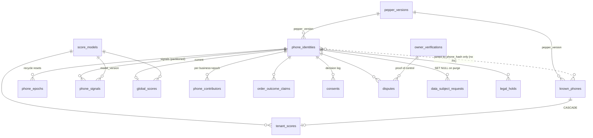

# scoring — data design (Phase 2)

Status: **Proposed** (Phase 2 gate). DB `scoring`, files under `src/Services/Scoring/Scoring.Infrastructure/Database/`.
Hard spec: CLAUDE.md §5. Sources: V1 Spec §1.3, §2, §4.4, §4.10, §6, §7.4, §10.3 · v0.2 §2.4–2.5, §3.3–3.4, §10 ·
ADR-0002/0003/0005 · analysis PDF §5.6, §6, §7, §8.3 (not binding). Validated on PostgreSQL 18.7 (Docker), 4 test files.

## 1. Purpose and ownership

Owns the **Contact Score**: phone identities (hash only), behavioural signals, score models, private (tenant) and
global scores, lookup audit, consents, disputes, phone-owner verification, data-subject requests for the global layer.
Does **not** own: raw phones, names, addresses, orders, calls (crm/orders hold them; scoring receives facts by event),
business trust weight (identity-access owns `businesses.trust_weight`; scoring keeps a read model), feature flags
(identity-access, ADR-0005), notifications (messaging), risk policy per tier (orders `risk_policy_rules`).

**Two planes in one database.** `public` = tenant plane (business_id + RLS; the merchant may see its own detail).
`net` = global plane (no tenant policy; **the API role has no USAGE on the schema**). The only bridge from the API role
into `net` is six `SECURITY DEFINER` functions with fixed `search_path` and minimal outputs.

**Runtime roles** (justification: a single role would make every engine function reachable from the merchant API
code; a DB grant boundary is the only guarantee that survives an application bug). Updated by the 2026-11-20
fix round (S9): the owner portal is its **own** role, split out of `scoring_app` — `scoring_app` is Scoring.Api
only. `scoring_engine`/`scoring_portal` are declared via `Database/roles.conf` (`engine`, `portal`), which already
gives bootstrap everything R1 asked for — no bootstrap-script change or workaround was needed.

| Role | Process | Rights |
|---|---|---|
| `scoring_app` | Scoring.Api: gRPC `GetScore`/`BatchGetScore` | SELECT on own tenant rows (RLS) on the 4 public tables; EXECUTE `public.lookup_score` only. No USAGE on schema `net` at all. No writes anywhere (S9) |
| `scoring_engine` | Scoring.Worker: consumers, recompute, nightly decay, DSR execution, erasure | Explicit grants only (schema `net` has no default privileges) on both `net.*` and the 4 `public.*` tables; NOBYPASSRLS; sets tenant from the envelope; EXECUTE `net.erase_phone` |
| `scoring_portal` | owner self-view OTP portal | No table grants anywhere. EXECUTE on the 5 `owner_*` SECURITY DEFINER functions only |
| `scoring_admin` | web-master console | SELECT across `net` for review queues; mutations only through `admin_*` SECURITY DEFINER functions (`admin_resolve_dispute`, `admin_release_legal_hold`, `admin_progress_dsr`, `admin_activate_score_model`, `admin_rotate_pepper`) — never a raw UPDATE on a state-machine table |
| `scoring_migrator` | migration job, partition job | owner; definer of every SECURITY DEFINER function |

A real pitfall worth recording: `ALTER DEFAULT PRIVILEGES ... IN SCHEMA public GRANT EXECUTE ON FUNCTIONS` (C0001)
auto-grants EXECUTE to `_app`/`_worker` on every new function created in `public` at `CREATE FUNCTION` time —
including the five `owner_*` bridge functions, even though only `scoring_portal` should ever call them. `REVOKE
ALL ... FROM PUBLIC` does **not** undo this (it only touches the PUBLIC pseudo-role). The migration explicitly
`REVOKE`s from `_app`/`_worker` by name before granting to the intended role. Caught by T0002, not by inspection —
every SECURITY DEFINER function added to `public` by any service needs this same explicit revoke.

## 2. Table catalogue (21 tables)

| Table | Spec table | Plane | Append-only | Partitioned |
|---|---|---|---|---|
| `net.pepper_versions` | — (pepper rotation) | global | no | no |
| `net.phone_identities` | phone_identities | global | no | no |
| `net.phone_epochs` | — (recycled numbers) | global | yes | no |
| `net.score_models` | score_models | global | yes (status/active_from/retired_at may change) | no |
| `net.settings` | — (limits enforced in DB) | global | no | no |
| `net.feature_flags` | feature_flags (read model, ADR-0005) | global | no | no |
| `net.business_trust` | businesses.trust_weight (read model) + §6.5 counters | global | no | no |
| `net.phone_signals` | phone_signals | global | yes (`is_valid`, `invalid_reason`, `invalidated_at`) | monthly `occurred_at` |
| `net.order_outcome_claims` | — (§6.5 one outcome per order) | global | no | no |
| `net.phone_contributors` | — (caps, k gate; derived) | global | no | no |
| `net.global_scores` | score_snapshots (global, current) | global | no (frozen by disputes) | no |
| `net.global_score_history` | score_snapshots (global, all) | global | yes | monthly `computed_at` |
| `net.consents` | consents | global | yes | no |
| `net.disputes` | disputes | global | no (state machine) | no |
| `net.owner_verifications` | — (OTP self-view, §7.4) | global | no | no |
| `net.data_subject_requests` | data_subject_requests | global | no | no |
| `net.legal_holds` | — (G10 brake) | global | no | no |
| `public.known_phones` | — (anti-oracle gate) | tenant | no (monotone read model) | no |
| `public.tenant_scores` | score_snapshots (business, current) | tenant | no | no |
| `public.tenant_score_history` | score_snapshots (business, all) | tenant | yes | monthly `computed_at` |
| `public.score_lookups` | — (lookup audit + rate counter) | tenant | yes | monthly `requested_at` |

Plus building blocks `app.outbox`, `app.inbox`, `app.audit_log`, `app.tenants` (C0002).

## 3. ERD (inside the service)

No FK into partitioned tables: `disputes.signal_id + signal_occurred_at`, `*_scores.history_id`, `order_outcome_claims.signal_id`
are documented references. External opaque refs: `business_id`, `order_id`, `interaction_id`, `user_id`, `resolved_by`.

## 4. Deviations from the spec (and who wins)

| # | Spec | Here | Why / source |
|---|---|---|---|
| D1 | One `score_snapshots` with `business_id NULL` = global, `is_current` flag | `tenant_scores`/`tenant_score_history` (public, RLS) + `global_scores`/`global_score_history` (net) | CLAUDE.md §5 "no business_id visible to tenants" on the global layer and grant isolation; current tables stay small and hot, histories partition and expire. `orders.risk_snapshot_id` = `tenant_score_history.id` |
| D2 | `consents.status` granted/withdrawn row with `withdrawn_at` | append-only decision log with `seq` (latest wins), exact `wording_text` + SHA-256 | conventions §5 (consents append-only); messaging uses `seq` as `source_version` |
| D3 | `phone_signals.business_id FK businesses` | opaque uuid, kept internal | ADR-0002; contributor never exposed (CLAUDE.md §5) |
| D4 | `businesses.trust_weight` read in-DB | `net.business_trust` read model + scoring-computed status/counters | identity-access owns the weight (its V0001); v0.2 §2.4 |
| D5 | Merchants with `score.view` see tier **and reason codes** (spec §6.5) | global layer: band + `low`/`high` label only; reasons only on the tenant layer, owner view and audit | Spec > CLAUDE.md in precedence, but the spec's own legal gate (§6.7 "tier only") and CLAUDE.md §5 agree on tier-only for the global layer; stricter reading kept — **Open question Q1** |
| D6 | Confidence none/low/medium/high | stored as spec; **merchant sees 2 labels** (`medium`→`low`) | 3 labels reveal the outcome-count band (N<2, 2–5, ≥5) = "signal counts" (CLAUDE.md §5) |
| D7 | `contributing_businesses >= k` | `phone_contributors` eligible AND **excluding the requester**, k from model params | otherwise a merchant plus k-1 sock puppets unlocks a score with its own data |
| D8 | — | `phone_epochs`, `known_phones`, `score_lookups`, `owner_verifications`, `order_outcome_claims`, `legal_holds`, `settings`, `pepper_versions` | CLAUDE.md §5 (recycling, no oracle, audit, OTP self-view), spec §6.5 (one outcome/order), G10, pepper rotation |
| D9 | Append-only `phone_signals` never deleted | DELETE trigger replaced (6 tables) by `net.guard_append_only_delete`: allowed only inside `net.erase_phone` for an in-progress delete DSR | G10 requires a hard-purge option; local override of the C0001 trigger — request R2 |
| D10 | Event-fed read model `source_version` | `known_phones` merges two producers: monotone upsert (`last_seen_at = greatest`, `has_order = OR`) instead | a single version guard is meaningless across crm and orders aggregates; upsert is naturally idempotent |
| D11 | Analysis PDF: separate network-plane DB, `merchant_pseudo_id`, negative events auto-expire 12–24 m, k=8–20 Beta prior | same DB, separate schema + roles; real `business_id` (needed for bulk invalidation/trust); expiry = retention (Q6); spec prior a=2.1 b=0.9 | spec/v0.2 win; PDF is analysis. PDF's Beta-Binomial = spec's smoothed rate (same family) |

## 5. Indexes ↔ queries

| Index | Query / consumer |
|---|---|
| `ux_known_phones (business_id, phone_hash)` | `lookup_score` gate; crm/orders consumers' upsert |
| `ix_known_phones_hash (phone_hash)` | **platform** fan-out without tenant: erasure (`erase_phone`) and pepper rotation (deviation from business-first, justified) |
| `ux_tenant_scores (business_id, known_phone_id)` | `lookup_score`; recompute upsert |
| `ix_tenant_scores_computed (business_id, computed_at)` | nightly decay job, per tenant |
| `ix_tenant_score_history_phone (business_id, known_phone_id, computed_at DESC)` | "score at order time" screen, backtests per tenant |
| `ix_score_lookups_business (business_id, requested_at DESC)` | DB rate limit (count in last minute/day); merchant lookup-audit screen |
| `ix_score_lookups_hash (phone_hash, requested_at)` | enumeration forensics (same number probed by many tenants); erasure |
| `ix_phone_signals_phone (phone_identity_id, occurred_at)` | recompute (spec §4.10); owner view; dispute check |
| `ix_phone_signals_business (business_id, occurred_at)` | velocity/sabotage detection; bulk invalidation of a flagged business |
| `ux_phone_signals_source (source_event_id, signal_type, occurred_at)` | idempotent ingestion (second layer after app.inbox) |
| `ix_global_scores_computed (computed_at)` | nightly decay job (stalest first) |
| `ix_global_score_history_phone` | dispute replay, backtest per phone |
| `ix_consents_current (phone_identity_id, purpose, effective_at DESC)` | consent gate in `lookup_score`; global-contribution filter in recompute |
| `ux_disputes_active` (partial, NULLS NOT DISTINCT) | one active dispute per (phone, signal); freeze trigger probe |
| `ix_disputes_queue`, `ix_dsr_queue` (partial) | web_master review queues ordered by due date |
| `ix_disputes_phone` | per-phone dispute rate limit (`owner_open_dispute`) |
| `ix_owner_verifications_phone (phone_hash, created_at DESC)` | OTP rate limit |
| `ix_legal_holds_active` (partial) | erasure brake |
| unique one-active (`score_models`, `pepper_versions`) | invariants |

## 6. Events

Consumed (inbox `app.inbox`, consumer = handler name; tenant from envelope):
- `crm.contact.created/updated/merged` → `known_phones` upsert, `phone_identities` create; `crm.contact.erased` → `known_phones.forgotten_at`.
- `crm.call.logged` → `phone_signals` (call_* types).
- `orders.order.placed` → `known_phones` (`has_order`), identities, velocity counters; `orders.order.confirmed/cancelled/delivered/refused/returned` (+ confirmation-link outcomes) → `phone_signals`, `order_outcome_claims`, `phone_contributors`, then recompute → `tenant_scores`/`_history`, `global_scores`/`_history`.
- `identity.business.created/updated` → `app.tenants`, `business_trust` (weight, source_version); `identity.feature_flag.changed` → `net.feature_flags`.
- consent capture from the confirmation page (orders) and `messaging.opt_out.received` → `net.consents` (event name for the orders one to be fixed in Phase 3).
Produced (`app.outbox`): `scoring.score.updated` (**tenant layer only**: business, phone_hash, tier, confidence, snapshot id, model version — never reasons/counts),
`scoring.consent.changed` (`source_version = seq`), `scoring.dispute.opened/resolved` (to messaging; no reasons for merchants).

## 7. Partitioning and retention [Guessing until legal R1]

`phone_signals`: keep while they can affect a score (≈ 4 half-lives = 24 months), then detach/archive or drop (Q6).
`global_score_history`, `tenant_score_history`: 24 months (backtests need ~1 year). `score_lookups`: 13 months (ANPDP
audit, enumeration forensics). The partition job calls `net.maintain_partitions()` (wraps `app.ensure_monthly_partitions`
and also revokes the engine role from every partition). Dropping a partition fires no row triggers (by design).

## 8. Security notes

- **No raw phone** anywhere: only 32-byte `phone_hash` (CHECK), pepper only in the secret store, `pepper_version` FK.
- RLS on the 4 tenant tables (FORCE); `net` invisible to `scoring_app`; partitions locked for both runtime roles.
- Secrets: OTP = HMAC-SHA256 with a separate key (`otp_key_version`); self-view session = SHA-256 of a 256-bit token.
- Definer functions: `search_path = pg_catalog, pg_temp` (tested), all names schema-qualified, explicit tenant check.
- PII in `net`: consent `evidence` (ip, user agent), dispute `reason_text` — internal only; erased by hard purge.

**Abuse cases considered and what stops each**

| Abuse | Stopped by |
|---|---|
| Enumerate numbers through the API (lookup oracle) | `known_phones` gate in `lookup_score`; global band also needs `has_order`; DB rate limit per minute/day; every attempt (incl. refused) in `score_lookups` with `ix_score_lookups_hash` for cross-tenant probing |
| Read global detail via a bug in API code | no USAGE on `net` for `scoring_app` (tested on every `net` table); lookup signature exposes only band/label/status (tested) |
| Read other tenants via a partition | partitions locked for app (C0001) and engine (`maintain_partitions`), tested |
| Learn counts/history from confidence | 2-label confidence; refusals for flag/k/consent/order all look like `not_enough_data` |
| Merchant sinks a number (fake refusals) | provenance weight forced from model by trigger; model CHECK carrier ≥ webhook ≥ manual; `manual_negative_cap`, `per_merchant_cap` params (mandatory keys); one outcome per order (`order_outcome_claims` PK); trust probation; bulk invalidation index |
| Sock-puppet merchants unlock or poison the global score | k counts only *eligible* contributors *other than the requester*; probation/flagged status in `business_trust` |
| Carrier/merchant-fault returns counted against customer | CHECK: every failure has `fault_class`; only `customer` counts (engine) |
| Third party's number given | `identity_disclaimed`/`wrong_number` are `flag` effect, weight 0 in model; disclaimers raise the business's counter |
| Recycled number inherits the old owner's history | `phone_epochs` + trigger derives `phone_epoch` from `occurred_at` (caller can't choose); lookups refused when merchant knowledge predates the epoch |
| Dispute spam to pin a good score / avoid new negatives | freeze bounded by `freeze_until` (non-extendable, tested), one active dispute per signal, 3 disputes / 90 days, only negative valid current-epoch signals disputable |
| Freeze bypass by the engine | `trg_dispute_freeze` on `global_scores` (tested, SQLSTATE 55000) |
| OTP brute force / existence probe | keyed HMAC, 5 attempts then `locked`, 5 challenges/day/number, start returns an id whether or not the number is known |
| Tamper with history | append-only (privilege + trigger) on 6 tables incl. for the owner; deletes only inside `erase_phone` for an in-progress delete DSR |
| Model tampering | params immutable after insert, state machine, single active model, `params_sha256` stored with each history row |
| Erasure during litigation | `legal_holds` refuse `erase_phone` (tested) |

## 9. Open questions

1. **Q1 Reason codes for the global layer** — spec §6.5 shows them to `score.view` merchants; CLAUDE.md §5 forbids. Implemented strict. Needs product + legal (R1).
2. **Q2 Flag semantics** — identity-access says the per-business row *overrides* the global row; implemented here as platform AND business (a business can only opt out), because the legal gate is platform-wide. Align with identity-access. [Likely]
3. **Q3 Order-creation race** — v0.2 §2.5: orders calls `GetScore` while creating an order, before `orders.order.placed` has made the phone "known". Proposal: scoring consumes `order.placed` and emits the at-creation snapshot id; or crm contact upsert precedes the order. Until decided, a first order of a new phone gets `not_known` → UNSCORED.
4. **Q4 Global layer in `scoring.score.updated`** — crm's `contact_score_cache` expects global rows by event. Pushing global changes to every merchant that knows the number leaks *timing* (a band change = another merchant reported something) and bypasses the lookup audit. Recommend: no global layer in events. [Likely]
5. **Q5 Frozen score display** — during a dispute merchants still see the frozen band (revealing the dispute would itself leak). Confirm with legal.
6. **Q6 Retention / erasure (G10)** — both modes built; which one, and whether consents survive a purge as proof of lawful processing, is a legal decision. Pseudonymise also keeps consent `evidence` (ip/user agent).
7. **Q7 Consent gate for display** (`global_display_requires_consent` = true) — strict reading of spec §6.7; could make the global score near-empty. Product + legal. [Guessing]
8. **Q8 Owner self-view when the platform flag is off** — signals (access right) always; score only if the platform flag is on (spec §7.4). Confirm.
9. **Q9 Thresholds** — all `settings` and model v1.0 params are [Guessing] (spec §10.3 #5).

## 10. Requests to building blocks

- **R1 RESOLVED** — no bootstrap-script or building-block change needed. `Database/roles.conf` already supports
  multiple extra-role suffixes; declaring `engine` and `portal` there gets both `scoring_engine` and
  `scoring_portal` created by the existing generic mechanism, LOGIN NOBYPASSRLS non-owner, same as any other
  service's extra role.
- **R2 STANDING** — `app.make_append_only` still has no `erasure_hook` parameter. Implemented as the described
  local override instead: `net.guard_append_only_erasure_delete()` replaces the generic DELETE-block trigger on
  the 4 net tables keyed to a phone identity that must support erasure (`phone_epochs`, `phone_signals`,
  `global_score_history`, `consents` — not the 6 originally estimated; `tenant_score_history`/`score_lookups`
  stay fully blocked because tenant-layer erasure is Q6/DECIDE, out of scope for `net.erase_phone`). The guard
  checks `current_setting('scoring.erasure_in_progress', true)`, set only inside `net.erase_phone`.
- **R3 RESOLVED IN THIS ROUND** — `app.lock_partitions` (C0001) now revokes from every grantee on the partition
  found via `aclexplode(relacl)`, not just `<db>_app`/PUBLIC, so no service-local `maintain_partitions()` workaround
  was needed here.
- **R4 RESOLVED IN THIS ROUND** — `app.audit_log.actor_kind` (C0002) now includes `phone_owner` directly.
- **R5 STILL OPEN** — ERD drawio (`docs/02-data/erd/scoring.drawio`) not produced in this task.

## 11. 2026-11-20 fix round — what was actually implemented

`src/Services/Scoring/Scoring.Infrastructure/Database/{migrations,seed,tests}/` implements the design above with
every **FIX**-disposition row from the review (X1-X7, S6, S7, S9, S10, S11 (mechanism only — see Q6), S12, S13,
S14 is **not** implemented — nightly decay doesn't exist yet, there is no job to flood; revisit when it's built)
and the **DEFAULT**-disposition rows as the conservative default described (S1, S2, S4, S5, P5), each as a
`net.settings` value or a structural choice, not hardcoded. **DECIDE**/**P3**/**LATER** rows (S3, S8, S15, S16's
runbook, E1, E3's confirmation) are deliberately left unimplemented, same as before.
Validated end to end against PostgreSQL 18 in `minicrm-pg` (docker compose, this repo root):
`tools/db/bootstrap-service-db.sh scoring Scoring --geo --reset` → `OK scoring`; `tools/db/audit-fks.sql` → 0 rows;
3 test files (`T0001` tenant isolation, `T0002` role matrix, `T0003` the `lookup_score`/OTP flow against real
data, including the S4/S7 freeze and version-guard regressions) all print `PASS`.
Simplifications versus the full design worth flagging (scaffold-honesty): `owner_view_score` returns a plain
month/had-negative-event shape rather than the fully worked-out coarse-granularity rules; there is no recompute
engine, nightly decay job, or velocity/sabotage detection yet (S14, S8 are consumer/worker code, not schema); the
k-gate, rate limits and oracle gate in `public.lookup_score` are real and tested, but the signal-ingestion and
score-computation pipeline that would populate `net.global_scores` in production does not exist yet — this
migration gives it a correct, secured place to write to.
